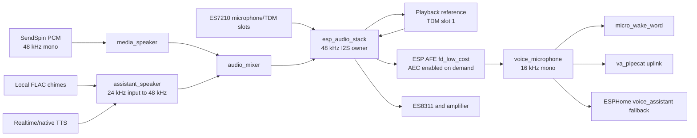
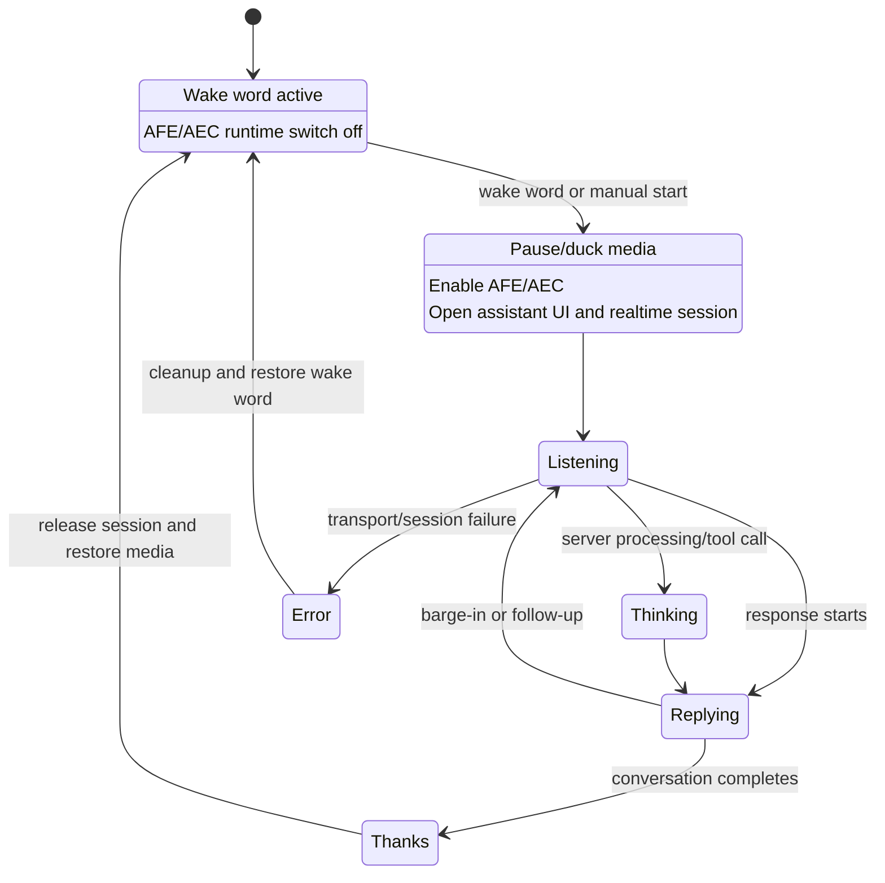
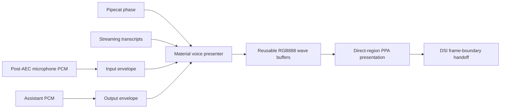

# Audio and voice architecture

The device has one coordinated duplex audio transport. Music, local chimes,
assistant playback, microphone capture, and AEC share the same physical I2S
clock domain and must not create independent hardware owners.

## Hardware topology

### Provider errors and diagnostic hooks

Gemini Live can fail while entering its connection context, before its receive
loop has installed error handling. The Pipecat adapter forwards this failure as
an urgent `provider_connection_error`, remembers it across a satellite wake,
and clears it only after `provider-ready`. The ESPHome receiver stops the broken
session, cancels no-speech/follow-up timers, and publishes a readable error.
The 2026-09-19 live server returned depleted prepaid credits; this is distinct
from microphone ingress or transcript rendering failure.

The diagnostic fix is present in the local Pipecat source and was tested in
the running HA add-on container on 2026-09-19. It is a reversible container
hotfix, not a new published add-on release: recreating/upgrading that container
from its old image will remove the deployed copy until a release is built.

Voice UI diagnostics must open the registered application. Revealing only its
top-layer widget leaves `ui_active_app` and weather ownership unchanged and can
falsely suggest missing transcripts. The text path is checked separately from
successful cloud inference.

Local chimes now use `device-startup.flac`, `confirm.flac`, and `error.flac`,
converted from the supplied desktop WAVs and embedded through `audio_file`.
They retain the shared decoder/mixer path; no independent I2S owner is created.

The display timeout uses the last user interaction, not LVGL redraw activity.
A physical touch cancels automatic return-to-blank after voice. Active voice,
Gallery, and Camera temporarily inhibit blanking without moving the timestamp.

| Function | Configuration |
| --- | --- |
| I2S sample rate | 48 kHz |
| Processed microphone rate | 16 kHz |
| Sample and slot width | 16 bit |
| Bus mode | Four-slot TDM |
| Microphone codec | ES7210 at `0x40` |
| Output codec | ES8311 at `0x18` |
| Microphone slots | 0 and 2 |
| Playback-reference slot | 1 |
| AEC reference alignment | Previous frame |
| Amplifier enable | GPIO53, default off |
| Physical output | Mono |

The current AFE configuration uses one microphone in `mr` input format. The
board exposes more microphone data, but multi-microphone separation is not
enabled because the measured CPU cost conflicted with realtime output and UI.

## Audio graph

`esp_audio_stack` is the only physical I2S owner. The speaker abstraction,
mixer, and resamplers feed it through bounded ring buffers.

## Full duplex and AEC

Full duplex means:

1. microphone frames continue arriving while music or assistant audio plays;
2. the exact playback signal is provided as a reference to the AFE;
3. the AFE subtracts echo and emits post-AEC microphone audio;
4. the voice transport may keep transmitting microphone data during TTS;
5. near-end speech can interrupt the assistant.

It does not mean separate, unsynchronized input and output peripherals.

The playback reference comes from the TDM reference slot and uses the previous
frame for timing alignment. AEC is enabled in the AFE configuration but its
runtime switch is normally off. Enabling `voice_audio_processing_switch`
activates processing for a conversation without rebuilding the hardware
pipeline.

Noise suppression, speech enhancement, AGC, and continuous local VAD are
disabled. Reasons:

- ESP-SR warns that NS may reduce recognition accuracy;
- multi-microphone BSS/SE consumed too much CPU in the current workload;
- continuous VAD kept a background microphone consumer active and could starve
  the post-AFE path;
- the realtime backend already performs semantic and server-side VAD.

## Idle versus conversation

The expensive processing path is active only between `Opening` and final
cleanup. Idle wake-word detection continues to consume microphone frames, but
does not require the full AFE feature set.

### Wake-word task memory reservation

The native92b candidate opts into `micro_wake_word.preallocate_task_resources`
(default `false` in the reusable component). Generated initialization reserves
the configured inference stack and internal task control block before LVGL
construction. Reservation does not start inference or microphone processing.
On this ESP32-P4 configuration it retains8192 bytes of internal stack and a
356-byte TCB, plus allocator overhead. Task priority, affinity, model, stack
memory type and DSP remain unchanged.

The inference task owns these buffers while running. The main loop retires
the parked task through `StaticTask::destroy()` before reusing them; opted-in
stop/start cycles keep the reservation. RTOS task-creation failure also keeps
it only when explicitly requested. Default callers still release resources
on creation failure and the default wake-word stop path still deallocates them.
This prevents later UI allocation from making the existing internal stack
impossible to allocate as one contiguous block.

`is_running()` includes startup and shutdown states and retains its existing
meaning. Product readiness and `debug_audio_output.wake_word_detecting` use
`is_detecting()`, which requires the inference task's ready event after buffer
allocation. This is lifecycle evidence, not an inference heartbeat or proof
that a spoken wake word was recognized. Allocation, frontend and inference
errors remain failures in device acceptance. See the latest section of
`docs/development/resume-2026-11-04-panels.md` for deployment/test status.

## Realtime conversation flow

The primary conversational transport is the external `va_pipecat` component:

1. A wake word or manual Assistant tile opens the registered Voice app.
2. Music is paused or ducked according to product policy.
3. AFE/AEC is enabled.
4. The persistent, authenticated Pipecat WebSocket is already warm and a new
   wake turn begins.
5. `voice_microphone` streams 16 kHz mono PCM through a PSRAM uplink ring.
6. Server phase, transcript, and normalized PCM-envelope events update the
   assistant presentation.
7. Incoming 24 kHz mono TTS enters a PSRAM playback ring.
8. `assistant_speaker` resamples to the 48 kHz mixer/output path.
9. During reply, microphone streaming remains active for barge-in.
10. Final cleanup disables AFE, restores idle wake words, and resumes media if
    the conversation actually ended.

The playback ring defaults to a 300 ms prebuffer. The backend may tune this at
runtime. The goal is to absorb network jitter without delaying the first audio
more than necessary.

The backend endpoint is provisioned automatically. `va_pipecat` registers a
hidden native API action, and the Pipecat Assist add-on sends the complete
authenticated WebSocket URL after discovering the device in Home Assistant.
The token is not stored in an HA text entity or logged by the firmware. A
periodic re-provision makes device and Home Assistant restarts self-healing.

The microphone callback is gated while no conversation is active. It does not
retain or replay pre-roll, so wake chimes and their acoustic tail cannot leak
into the next Pipecat turn. Speech should begin when the listening state is
visible.

## Voice assistant presentation

The Voice application is a full-screen black scene with no on-screen controls.
It is closed only through the normal application-close gesture, which also
terminates the Pipecat session. The visual hierarchy is:

1. a small phase label at the top (`Listening`, `Thinking`, `Answering`,
   `Thanks`, or an error state);
2. a bounded rolling dialog in large centered paragraphs;
3. a three-line purple waveform over a bottom-anchored purple gradient.

The dialog keeps at most three paragraphs: the immediately preceding assistant
answer in white, the current user turn in gray, and the current assistant
answer in white. When a follow-up starts, the older user paragraph is removed,
the preceding assistant answer moves up, and the new user paragraph enters
below it. This preserves conversational order without allocating an unbounded
history or another display-sized surface. If the three blocks exceed the text
region, they are bottom-aligned so the newest turn remains visible.

Navigation is the sole owner of Voice visibility. A wake word must open the
registered `voice_application` through `lvgl.navigation.open`; it must not
directly unhide the overlay or activate the waveform. This guarantees that the
black LVGL surface has completed its transition before the direct presenter can
draw and that the close gesture owns an active application even before the user
speaks.

Backend phase and transcript callbacks only update content inside an already
open Voice application. A local close sets `voice_assistant_stop_requested`
before sending `end_session()`, so delayed `listening`, `replying`, transcript,
or idle callbacks cannot reopen the scene while navigation returns to Home.
Clear that latch only when a new navigation-owned Voice opening begins.

A wake-word opening records whether the backlight was off before `display_wake`
runs. A terminal Pipecat reply enters `thanks`; the device component keeps that
state visible for 1200 ms and then emits `idle`. This terminal `idle` closes the
navigation-owned Voice application. Only after the close transition completes
may the backlight return to its recorded off state. A Voice session opened from
an already-lit display returns to Home without changing display power. Manual
tile and diagnostic opens always count as display-on origins.

The Pipecat bridge must not expose raw model tokens as display events. It
normalizes cumulative and token-style sources, accumulates each RTVI observer
(`bot-output`, transcription, TTS text, and LLM text) independently, selects
one authoritative source by priority, and emits cumulative phrases: four words
for user partials and six
words for assistant partials, or earlier at punctuation and at turn end. A
pending final phrase may share one protocol message with the following phase;
the ESPHome parser therefore processes both fields instead of returning after
the transcript. This preserves the final words without briefly losing the
`listening`, `thanks`, or terminal transition. Never append chunks from two
assistant observers to one accumulator: differing chunk boundaries and
punctuation can otherwise duplicate a complete clause on the device.

Device-side transcript updates remain latest-wins and are committed at most
every 100 ms. A new paragraph fades and translates into place over seven 33 ms
steps; the bounded dialog shifts upward in the same animation, while cumulative
phrase continuations update in place. Streaming text therefore does not restart
the entrance animation or create a second raster pass.

The ESP-IDF WebSocket client can deliver one JSON text message in multiple data
events. `va_pipecat` must assemble text events by `payload_offset` and
`payload_len`, including opcode-zero continuation frames, and call the JSON
parser only after the complete payload is present. Parsing each data event as a
standalone message silently drops longer transcript updates while binary audio
continues to work, producing the misleading symptom of audible answers with no
captions.

The declarative LVGL phase and transcript labels define geometry, fonts,
colors, and wrapping only. After setup the material presenter hides them and
owns two fixed RGB888 direct regions: one for status and one for the complete
transcript panel. It rasterizes UTF-8 glyphs with the configured immutable LVGL
fonts into reusable PSRAM buffers and submits only those regions through the
regional PPA presenter. The entrance fade and vertical translation are also
drawn inside the transcript region. The wave frame is scheduled before phrase
rasterization so a 30-45 ms PSRAM text pass cannot postpone the independent
wave worker. Live text must never be switched back to native label updates: in
RGB888 DIRECT mode that invalidates a large native area, runs font/layout work
in the LVGL loop, and stalls the independent wave. The presenter never
allocates a full-screen text buffer or allocates per phrase.

Animated transcript frames remain ordinary asynchronous regional updates. Once
the paragraph animation becomes idle, the final transcript submission is a
stable boundary: the compositor drains pending work and carries that rectangle
to every idle DSI framebuffer. This prevents a later framebuffer rotation from
revealing an older text state without retaining another 680x360 PSRAM copy.

`va_pipecat.on_audio_level` publishes separate normalized input and output PCM
envelopes. The presenter selects input while listening and output while
speaking, applies its own attack/release smoothing, and falls back to a slow
breathing wave during thinking or silence. It never reads PCM directly.

The waveform is not an LVGL object tree animation. A low-priority raster worker
builds one 660x190 RGB888 region in two reusable presentation slots while the
regional PPA compositor runs on the other core. The renderer owns exactly one
backdrop and two in-flight buffers (1,128,600 bytes total) for its lifetime,
does not allocate per frame, and coalesces work when both slots are busy. Each
slot tracks the rows touched by its previous wave and restores only that dirty
vertical span from the immutable backdrop before reuse; copying the complete
660x190 backdrop every frame wastes PSRAM bandwidth. Stopping the application
drains both slots before releasing the direct region.

At the validated 30 Hz setting, the dynamic Listening/Answering benchmark
presents 60-61 frames per two seconds with request, render, and submit counts
equal and no slot starvation. Dynamic raster work averages roughly 10-13 ms
and regional presentation roughly 9 ms. With the real microphone and AFE
active, the presenter remains at about 30 FPS and raster work averages 5-6 ms.
The media-player direct presenters must be quiesced before Voice takes the
region queue; deliberately running both workloads reduced the wave to roughly
15-23 FPS. A full-screen diagnostic JPEG capture is a separate stress
operation and must not be included in these steady-state figures.

Native LVGL text invalidation is expensive in RGB888 DIRECT mode. Before the
direct text regions, a synthetic word-at-a-time stream reduced the wave to
5.4-22.9 FPS and produced 187-283 ms LVGL loop spikes; even phrase updates
caused 116-161 ms stalls. With phrase batching and direct text presentation,
the cumulative-phrase benchmark keeps the wave at 28.8-30.4 FPS after the
initial full-page handoff, bounds the LVGL loop to 1-8 ms, and reports zero
native invalidated areas, zero native invalidated pixels, and zero DSI
underruns. The one-time first acquisition of the three direct regions measured
23.3 FPS and is tracked separately from streaming phrase updates. Phrase
batching remains part of the wire contract because it avoids unnecessary
raster submissions, while the direct regions remove the full-screen LVGL
refresh from the critical path.

## Barge-in

During `replying`, post-AEC microphone audio is still transmitted. When speech
is detected:

1. the device sends an interrupt;
2. pending assistant audio is flushed or suppressed;
3. the backend cancels the active response;
4. phase moves directly to `listening`;
5. user audio continues in the same session.

There must not be an intermediate `idle` phase between `replying` and a valid
follow-up. `idle` means the conversation has ended and may resume music, which
would contaminate the next microphone turn.

The `stop` wake-word model is enabled only where product policy needs a spoken
conversation stop. A manual close must call session termination, stop
assistant output, disable AFE, and restore the normal wake-word model.

## Phase ownership

The backend owns conversational phases:

| Phase | UI | Audio policy |
| --- | --- | --- |
| `idle` | Assistant hidden after cleanup | AFE off, normal wake word active, media may resume |
| `listening` | Listening scene and user transcript | AFE on, mic streaming |
| `thinking` | Thinking state; keep Assistant visible | AFE on, media remains paused |
| `replying` | Answering scene and assistant transcript | TTS playing, mic still streaming |
| `thanks` | Short completion state | Drain output, then cleanup |
| error/not ready | Error state and chime | Stop broken session, return to idle wake if possible |

These phases also own display power policy. While Voice is active and the
backend reports `waiting`, `listening`, `thinking`, or `replying`, sleep is
inhibited without modifying the last-interaction timestamp. A manual closing
gesture updates that timestamp and clears wake-from-dark restore intent. After
closing, Home uses the normal touch-based timeout. A stale backend phase must
not keep Home awake after the conversation view has closed.

The device must not invent a `thinking` transition merely because no audio is
currently playing. It follows the backend phase message.

## Native Home Assistant fallback

The ESPHome `voice_assistant` component remains configured for Home Assistant
Assist fallback behavior, timers, and compatibility. It uses the same
post-AFE microphone and assistant speaker. It is not allowed to compete with
the realtime session for microphone or output ownership.

Only one session controller may be active. Product scripts arbitrate wake word,
realtime, and native paths.

## Mixer and media policy

The mixer has two sources:

- `media_mixing_input`, with a 100 ms source buffer;
- `assistant_mixing_input`, with a 1000 ms source buffer.

SendSpin requests lossless mono PCM at 48 kHz. This avoids decoding stereo FLAC
on the P4 only to downmix it later. Its audio receive quota remains 600,000
bytes and its initial synchronization delay remains adjustable. Sendspin 0.9.3
stores audio, artwork, and protocol messages in one ordered receive ring, so
the quota is no longer the size of its complete allocation.

The product opts into `sendspin.optimize_memory` in the companion fork. For
PCM-only formats, the receive budget uses the lowest configured PCM payload
rate; compressed codecs retain the library's conservative rate. At 48 kHz mono
16-bit, the unchanged audio quota can hold at most seven whole seconds, rather
than the 52 seconds assumed for compressed audio. Keeping the artwork quota,
maximum message sizes, time-sync allowance, and original advertised audio
capacity gives a 1,006,864-byte ring instead of 1,331,472 bytes. The reusable
option defaults off and accepts only the reviewed native 0.9.3 dependency.

The same opt-in gives each artwork transfer one assembly buffer sized to its
announced encoded payload, up to the unchanged 262,144-byte cap. The artwork
thread owns it while assembling or waiting behind an acknowledgement gate. It
releases it after the synchronous decode callback returns, or when the pending
image is discarded. The later display deadline retains only a timestamp and
epoch. Allocation failure drops the new image and leaves the current cover
valid; it does not change the audio quota or disconnect the transport. This
removes the library's additional permanent 262,144-byte encoded assembly while
retaining the product's separate latest-cover cache.

Protocol, HTTP, and artwork worker stacks keep their original sizes and move
15,872 bytes from internal memory to PSRAM through the existing hub option.
The timing-sensitive media sync task remains in internal memory with its
unchanged 6,192-byte stack. The physical TDM, mixer, AFE, resampler and realtime
voice buffers retain their existing owners and capacities.

### Sendspin checked startup

The native109 candidate replaces the five Sendspin 0.9.3 worker thread
holders with a nonmoving, fallible `PlatformThread`. Each role owns its
holder and callback context until join finishes. The inline trampoline
borrows that stable address; it does not allocate a `std::thread` state.
Stack sizes, priorities, PSRAM capability requests and existing worker
functions stay unchanged. Invalid join or destruction while joinable remains
fatal, so a failed ownership invariant cannot silently free a live context.

Configuration must succeed and read back exactly before `pthread_create`.
A rejected start leaves no joinable holder and never waits for that worker's
IDLE signal. The role withdraws its failed consumer binding or transient
buffer; the client stops earlier roles before releasing their receive ring.
Protocol failure first closes server admission and stops the connection
manager, then discards the published snapshot outside its mutex and performs
the existing command/role/ring cleanup. Source's persistent capture ring and
encoder keep their previous lifecycle; the failed outbound ring is released.

`sendspin.startup_retries` is an independent native ESP-IDF option, range 0–4,
default 0. The product selects 4. The first start is immediate. Only an actual
resource failure schedules up to four additional attempts after 1, 2, 4, 4 seconds;
invalid configuration, identity or pairing failures remain terminal. The
failure classification belongs to the current client attempt and resets
before every start. No heap-size precheck, new task, buffer or scheduler entry
is introduced. Disabling or shutting down cancels a pending series; repeated
enable does not refill its budget. With retries enabled, an explicit
disable/enable can start a fresh bounded series. Default0 preserves the
existing terminal-failure policy.

The checked native patch is installed independently of `optimize_memory`.
Its CMake hook accepts only the reviewed source hashes, checks all inputs
before writing and is idempotent. The original thread path remains behind
the disabled guard for unsupported build paths; nonnative retry requests are
rejected by schema validation.

Worker refusal records distinguish configuration/read-back (`phase=1`) from
an attempted `pthread_create` (`phase=2`). The hub records an actual successful
start as `Sendspin startup running; retries=N`. Retry-enabled products emit
this one health result at WARN level to remain visible with their boot log
filter, without setting component warning status. A generic pthread error
alone is not a handled failure: boot qualification must correlate the exact
owned refusal, bounded retry and later running result. Abort and panic remain
fatal.

**Validation boundary:** candidate109 has focused host fault-injection and
cleanup checks, 21 extracted Hub scenarios, 6 schema cases, 3 actual codegen
combinations and 7 ESP32-P4 translation-unit compilations. Host dependencies
are test doubles; these are not network, concurrency, playback or hardware
acceptance. The all-role P4 probe measures each worker holder 4→20 B and Hub
280→288 B, with Client 504 B unchanged; the actual product disables Source
and Visualizer and has a 496 B Client. Full linked and device results must be
recorded separately in the checkpoint.

ESP-IDF 5.5.6 can ignore a failed `pthread_setspecific` while installing a new
configuration. Read-back prevents creation with a missing or stale
configuration, but cannot reclaim an SDK allocation whose pointer was lost
inside that API. The repair does not claim every allocator failure is
leak-free. Native108's first boot aborted through unchecked SsProto thread
creation and automatically rolled back to107; its exact failed evidence is
retained. This startup repair does not resolve the separate Agenda107 TLSF
fault described below or establish whole-device stability.

Announcements and assistant audio use the assistant source and duck media by
20 dB. Media is unducked only after:

- assistant output is drained;
- the conversation is truly idle;
- no timer announcement is active.

## Local sounds and amplifier sequencing

Boot, listening, and error sounds are local FLAC assets exposed through
ESPHome's `audio_file` and `media_source.audio_file` components. They use the
same announcement pipeline as voice output; there is no separate ad hoc codec
or I2S writer.

The 2026-09-19 user-provided WAV files are encoded losslessly as mono 48 kHz,
16-bit FLAC to match the mixer, with no runtime sample-rate conversion:

| Event | Asset | Duration | Encoded bytes |
| --- | --- | ---: | ---: |
| Startup, during the final boot phase | `device-startup.flac` | 4.800 s | 180689 |
| Assistant invocation | `confirm.flac` | 2.467 s | 49349 |
| Assistant error | `error.flac` | 2.396 s | 50220 |

The boot sequence waits for the announcement to finish decoding before the
backlight fade-out. The mixer and I2S may still be draining the last PCM
frames. The announcement wait is bounded at six seconds so a broken audio
source cannot trap the boot sequence.

The parked audio task prepares its working buffers before opening a PCM
session. A failed preparation attempt returns the request to idle with a
one-second delay so early heap pressure cannot disable audio for the rest of
the boot. The main loop queues the next attempt, and the task retains the
existing I2S reservations while waiting. The boot sequence allows up to two
seconds for preparation before continuing to the wordmark.

The amplifier defaults off. It may be enabled only after:

- I2C codecs are configured;
- I2S channels and DMA buffers exist;
- the output chain has been primed or is ready to receive silence/audio.

This ordering avoids the boot pop caused by exposing codec and DMA startup
transients to the physical speaker.

### Mixer session handoff

The native107 repair gives each `SourceSpeaker` exclusive ownership of one
ring, one reader and the captured stream format. Its existing `source_mutex_`
guards publication, retirement and a bounded lease count. A move-only
`SourceLease` holds the owner pointer rather than a shared-pointer control
block. A successful acquisition keeps both objects stable until that lease
is released. The producer holds its lease across a blocking write; the mixer
holds its lease across mixing and the associated output transfer. PCM work
and blocking writes remain outside the mutex; short reader bookkeeping keeps
the existing lock discipline.

STOP withdraws publication before waiting for all leases. Lease release only
decrements the count; it never deletes audio objects. The component's main
loop alone retires the session: under the mutex it verifies zero leases,
marks retirement and moves both unique owners locally. Outside the mutex it
destroys the reader before the ring, then clears retirement under the mutex.
No replacement can publish during destruction, and queued START still waits
for the existing STOPPING/output-drain conditions. Object-allocation failure
does not publish a partial session.

`RingBufferAudioSource::create_borrowed` takes a non-owning ring pointer. Its
caller must keep the ring alive until the reader is destroyed and any held
ring item is returned. The mixer satisfies that rule through session leases
and reader-before-ring retirement. The existing shared-owner factory remains
available to other clients with its previous lifetime contract. This repair
does not replace shared ownership throughout the audio stack or change the
toolchain's threading policy.

There is still one producer and one consumer per ring. No new task, PCM
buffer, ring capacity or I2S owner is introduced. Formats, conversion,
ducking, pause, queue policy, and stop/finish/timeout behavior remain within
the existing audio path.

**Validation boundary:** native106 built and linked, but its first chime boot
panicked while destroying the assistant source's shared control block; the
device recovered automatically to105. The exact traceback and linked code
support an unchecked pthread-mutex initialization failure under memory
pressure, but that return value was not captured. Keep the original failed
boot and diagnosis separate from the repair's evidence. Native107's thirteen
host scenarios and three ESP32-P4 translation-unit compilations passed.
The target probe reports `SourceSpeaker`164→160 B and
`RingBufferAudioSource`52→56 B (including other reader clients), with mixer
and ring object sizes unchanged. These source/host/ABI checks remain separate
from linked and device evidence. Full107 build/linked passed after a same-source
disk-space continuation; the original ENOSPC failure is retained. One OTA's
first boot and five controlled software restarts passed scoped digital-audio
and wake checks, with seven local playbacks and five reviewed Home originals.
Known recovered4096-byte stack allocation retry remains; no strict-clean,
physical power-cycle or acoustic claim is made.

The later Agenda107 campaign nevertheless panicked after App6 closed and Home
resumed, before its final Settings/health batch. The decoded fault is in TLSF
allocation on the lwIP/DSI diagnostic logging path, not evidence of another
shared-control-block retirement. Its cause is unresolved; the pending audio
query does not establish audio ownership as the cause. Read-only recovery
observed107/127/layout399, digital audio and wake without new faults for35s,
but does not erase the failed campaign. Native107 is not accepted as a whole.
See the [current checkpoint](../development/resume-2026-11-05-datetime.md).

The product records the number of PCM frames successfully submitted by the
I2S output task, excluding silence inserted for underruns. The boot chime logs
the counter at both ends, and `debug_audio_output` reports the same counter,
amplifier switch and mute/volume state. These measurements verify the digital
output path. The amplifier switch reports its commanded state; neither
measurement is an acoustic recording.

## Task placement

| Task | Core | Priority | Purpose |
| --- | --- | --- | --- |
| Audio stack | Core 0 by default | 19 | I2S RX/TX and frame processing |
| AFE feed manager | Core 0 | 10 | Move physical frames into ESP-SR |
| AFE processing/fetch | Core 1 | 10 | AEC and processed microphone output |
| Realtime playback drain | Unpinned | 11 | Drain 24 kHz TTS into assistant speaker |
| Realtime microphone TX | Unpinned | 6 | Send microphone chunks over WebSocket |

The audio task is above lwIP priority 18 but below WiFi priority 23. Do not
raise UI workers above it. Visual work may drop/coalesce frames; audio cannot
drop timing deadlines without audible corruption.

## Buffer rules

- Audio rings may live in PSRAM, but I2S DMA descriptors and hardware DMA
  buffers require suitable internal/DMA-capable memory.
- Audio callbacks must not allocate, log verbosely, perform HTTP work, or call
  LVGL.
- Cross-task state is atomic or passed through bounded queues/rings.
- Flush requests are executed by the audio owner, not by concurrently mutating
  ring-buffer internals from the main loop.
- Start/stop must wait for the audio task state machine rather than repeatedly
  creating and deleting I2S tasks.
- AEC reference and microphone frames must remain aligned; changing channel or
  slot mappings requires a loopback test.

## Failure signatures

### Repeated microphone sessions

Static FreeRTOS tasks must not reuse their TCB or free their stack while the
task is still current on either core. A stopped event, or even `eSuspended`,
can be observed before the other core has finished its context switch. The
shared `StaticTask::destroy()` now suspends the task and waits for it to leave
both cores before deletion. This follows the IDF `vTaskDeleteWithCaps` lifetime
rule and is important when microWakeWord is stopped for a conversation.

The direct AFE fetch task keeps its static TCB and stack between sessions. It
suspends after finishing a fetch and is resumed only after that suspension is
observed. Do not self-delete and recreate it in the same static TCB: deferred
IDLE cleanup can still reference that storage. Changing only the AFE task did
not eliminate the observed repeated-open watchdog; keep that distinction in
the validation record.

| Symptom | First suspects |
| --- | --- |
| Wake word works, conversation mic is silent | AFE runtime switch, consumer ownership, stale ring, or session not committing mic |
| Assistant voice is high-pitched | 24/48 kHz format mismatch or duplicate resampling |
| TTS breaks up | Playback prebuffer, audio task starvation, WiFi delivery, or ring underrun |
| Music breaks up only during voice | AFE CPU load, incorrect media pause/duck policy, or PSRAM contention |
| Assistant hears itself | Missing/wrong playback reference, AEC disabled, or reference-frame misalignment |
| Barge-in switches to listening but hears nothing | Output not flushed, mic gate not reopened, or backend immediately sends idle |
| Boot pop | Amplifier enabled before codec/I2S stabilization |
| `Cannot receive audio, buffer is full` | Output not drained or stale session/audio generation |

## Source map

Reusable implementation:

- `esphome/components/audio_processor/`
- `esphome/components/esp_afe/`
- `esphome/components/esp_audio_stack/`
- `pipecat-homeassistant/components/va_pipecat/`
- `esphome/components/sendspin/`

Product configuration and policy:

- `modules/hardware/audio.yaml`
- `modules/voice_assistant/runtime.yaml`
- `modules/player/runtime.yaml`

## Boot chime and media-volume restoration (2026-09-21)

The boot sequence owns the audio-ready gate. Assistant listening/confirmation
and error chimes must require all of the following:

- `boot_sequence_done`;
- `boot_audio_ready`;
- `!ui_snapshot_io_busy`;
- the normal user-facing switch/condition.

This prevents a backend/provider error received while the device is still
building the first Home snapshots from playing an assistant error sound over
the startup sound. It does not hide the provider error from logs.

When Assistant releases the media player, restore the requested device volume
before calling `media_player.play`. Restoring only after the first media
buffer is queued can leave the first part of the resumed stream at the
announcement ducking level. The fix logs requested percentage, output volume,
hot-output volume, and master gain together so a percentage/curve problem can
be separated from a stale mixer state. In the 2026-09-21 COM5 run a 50%
request was restored before playback (`output=0.060`, `hot=0.060`,
`master=1.000`).
