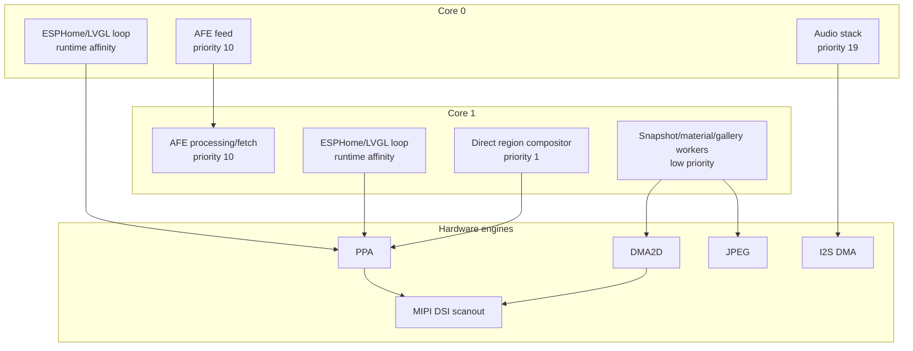

# Runtime tasks and memory

The ESP32-P4 has enough PSRAM for this interface, but bandwidth and contiguous
blocks are finite. Performance depends more on ownership and transfer timing
than on the raw percentage of free CPU.

## Scheduling model

This diagram shows the intended separation, not a promise that every task is
permanently pinned. The display scanout and accelerators run in hardware.
Auxiliary composition is moved off the LVGL loop where practical. Some workers
are deliberately unpinned so FreeRTOS can avoid a temporarily busy core.

## Software restart diagnostics

The optional ESPHome `esp32_hosted.restart_diagnostics` feature defaults to
disabled. When enabled on a target with RTC memory, it retains one 60-byte
record of the first intercepted restart request: return PC, core, tick,
full 32-byte ELF SHA256, version and checksum. It allocates no heap, NVS,
task or framebuffer. A concurrent requester waits at most one millisecond for
the first writer; an incomplete record has no valid commit marker.

Hosted transport requests are intercepted at its public mutable OS callback
before its generic `esp_restart` call. This preserves the SDIO caller rather
than only the shared Hosted restart function. The early hook replaces the
callback only if it still points to the original SDK implementation and emits
`ESPHOME_HOSTED_RESTART_DIAG installed=1` directly through ROM UART. It leaves
custom callbacks intact. The port configuration header must precede the OS
abstraction header: the table layout depends on the configured transport and
mempool. Revalidate the callback ABI against the actual SDK object after an
SDK update. A linker wrap alone cannot redirect the SDK's same-object table
initializer. Both interception paths share the original first-writer record;
the nested generic restart cannot overwrite the earlier Hosted caller.

The product keeps `esp-idf: INFO` because ESPHome's SDK log bridge forwards
even SDK errors at its compiled INFO level. With transport diagnostics disabled,
the SDK logging maximum remains ERROR. Worker logs can still be queued at
reset, so immediate ROM markers and the retained request are restart evidence.

### Targeted transport logging

`esp32_hosted.transport_diagnostics` defaults to false and requires
`restart_diagnostics: true`. The R18 diagnostic product explicitly enables it.
It reuses the existing diagnostic component; it adds no task, timer or display
buffer and does not change transport failure/restart policy, reset timing,
SDIO clock or firmware versions.

The opt-in generates `USE_ESP32_HOSTED_TRANSPORT_DIAGNOSTICS` and applies its
SDK settings at code-generation priority `FINAL`, after ESP32's ordinary
logging defaults: compiled maximum INFO, maximum-equals-default disabled,
dynamic level control enabled, tag-level NONE disabled, and
CACHE_AND_LINKED_LIST enabled. The product's default runtime level stays
ERROR. Enabling `restart_diagnostics` alone does not raise the SDK maximum.

At setup priority HARDWARE (800), the component enables INFO for six tags:
`H_SDIO_DRV`, `sdio_wrapper`, `transport`, `H_API`, `os_wrapper_esp` and
`RPC_WRAP`. It preserves the existing RPC core/response/event tag policy.
`ESPHOME_HOSTED_TRANSPORT_DIAG enabled=1 tags=6 max_level=3 sdio_level=3`
confirms filter installation, not successful C6 communication.

The Hosted SDK's C constructor calls `esp_hosted_init` before `app_main` and
component setup. INFO enabled at setup800 cannot recover earlier constructor
messages filtered at runtime. Missing early INFO therefore does not prove
that initialization was skipped. Mutable-callback interception also starts at
setup800; an earlier request can therefore lack its outer Hosted caller even
when the generic restart wrapper records it. Logging changes timing and memory;
R18 diagnostic throughput must be identified separately from R17's baseline.

The diagnostic component is registered before Safe Mode's early return and
reads the record before Wi-Fi initialization. It accepts a record only after a
software reset with valid metadata and checksum, then consumes the RTC marker
and retains an immutable DRAM copy for read-only getters and repeated
`dump_config` reports over the normal ESPHome log API. A previous image's
record remains reportable with `same_firmware=no`; resolve that PC against the
recorded ELF hash, not the running image. RTC retention across an image change
is best effort because linker layout can change. Missing or rejected data does
not establish a reset cause. This records an intercepted restart request, not
a panic, no-OS restart or hardware reset, and does not change restart policy.

### SDMMC transaction error preservation

`esp32_hosted.preserve_sdio_transaction_errors` defaults to false, is exposed
only for SDIO, and accepts true only with the reviewed ESP-IDF 5.5.5 or 5.5.6
sources. The exact recognized upstream-fixed body is retained unchanged.
R20 enables it and restores R18's 1500 ms post-reset settle; the failed R19
5000 ms experiment is removed. Relative to R18, this changes SDK error
preservation, not transport clock, pins, reset pulse, protocol or restart policy.

On opt-in, code generation registers the local native IDF component
`sdmmc_framework_patch`, matching its directory basename. Its
`Kconfig.projbuild` owns `CONFIG_ESPHOME_SDMMC_PRESERVE_TRANSACTION_ERROR`,
default n. This is an SDK driver option, not an application-only define.
CMake invokes the versioned patcher with IDF_PATH during configure and fails
closed if the reviewed owning function/cache block is unknown, duplicated or
mixed. The patcher recognizes its exact guarded form idempotently and leaves
the recognized upstream-fixed body unchanged. It preserves line endings and
uses no SCons-only hook.

At final M2C cleanup, synchronization still runs after a transaction error.
An earlier transaction error wins; an otherwise successful transaction adopts
the final sync result. If both fail, the original error is retained and the
secondary sync error is logged. This backports official error precedence
from Espressif commit `5038e2ad53422c144db832ab65130956ec7e23de`. It does not
add a buffer, copy, cache fence, task or transport recovery mechanism and
preserves the existing request mutex and DMA ownership.

The SDK cache is shared between builds, so the installed source is guarded
by the SDK symbol. The OFF branch retains the exact original body, including
when an earlier ON build installed the source guard. Without the local
component the symbol is undefined and the original branch compiles. A
framework already containing the recognized upstream fix naturally retains
its upstream behavior. The option affects the owning SDMMC data-transaction
driver, rather than only Hosted packets.

The current Hosted retry still reuses its running SDIO reader, card context
and cumulative receive count without a cooperative stop/ACK before card
reset/reinitialization. A failed payload also advances the announced receive
count. Error preservation makes a failure report honest; it does not repair
that lifecycle or prove that the peer is ready. Full-image and physical R20
acceptance are separate from the source/configuration checks below.

### Orderly coprocessor shutdown reset

`esp32_hosted.reset_coprocessor_on_shutdown` defaults to false, is SDIO-only
and accepts true only for the reviewed IDF 5.5.5 or 5.5.6 lifecycle. R21 enables it.
Code generation registers `ShutdownResetComponent` before Safe Mode's early
return and emits `USE_ESP32_HOSTED_SHUTDOWN_RESET`. At setup priority HARDWARE
(800), the component validates the SDK native reset-pin metadata/polarity and
registers one IDF shutdown callback. Setup performs no GPIO writes. The SDK
constructor already initialized host metadata before component setup; this is
not a replacement startup initializer. Duplicate/invalid registration fails
the component and is an invalid experiment, not a prevention success.

During orderly IDF shutdown, the callback restores native GPIO function,
sets the configured inactive latch before enabling output and requests a
nominal 1000 us ROM delay. It uses no GPIO hold, allocation, task, RTOS wait,
RPC, Hosted deinit, SDIO drain or new recovery policy. Its once flag avoids
repeating/lengthening a sequential assertion; it does not serialize concurrent
restart callers. It cannot guarantee electrical pulse duration or continuity
through subsequent ROM startup. Hardware watchdog, panic/no-OS or earlier
resets need not pass through this orderly callback.

`is_registered()`, `is_shutdown_assertion_complete()` and
`get_shutdown_result()` describe current-boot registration/assertion only.
Initial ESP_OK with completion false is not evidence of GPIO execution.
Completion follows successful GPIO operations and the nominal delay. State
is not RTC/NVS history and does not prove that the previous boot asserted
reset. Restart-request RTC diagnostics remain a separate mechanism.

### IRAM panic diagnostic

R21 separately enables `CONFIG_ESP_PANIC_HANDLER_IRAM=y`. It changes panic/
required-UART code placement, retaining print-and-reboot, zero reboot delay,
no GDB stub or coredump, UART 115200, interrupt watchdog 800 ms and task
watchdog 30 s. The six affected objects total 6504 bytes in the static bound;
this is not measured incremental linkage cost or final headroom. The complete
new ELF/map and internal RAM must be checked before flash.

IDF's flash-app panic entry still attempts `panic_enable_cache()`. Placement
does not guarantee a trace for hardware reset, an invalid stack, a blocked
cache enable, a fault before panic entry or an unavailable serial path. It
does not locate R20's watchdog or make the shutdown GPIO callback panic-safe.
R21's bounded five-restart and captured-boot checks passed; its full matrix
was not run. R22 remains a partial, unaccepted campaign. R23 initial boot, first five
software restarts, 12 original main steps including warm/persisted, Camera/Volume
state checks and targeted Volume accent pixels passed. One natural DMA INVALID
was repaired. Warm accent and matched overcast passed in their recorded
intervals. The later warm restart campaign passed its first request but failed
on the second with a real core1 Store access fault, rejecting R23. Final health
and physical cold five were not run after that failure.
Diagnostics are not a performance baseline.

### Boot drain admission

After the splash is stopped/hidden with the panel dark, product boot waits for
`lvgl_esphome_direct_regions_pause(true, 500)` before the first quiet period,
ordinary LVGL refresh or snapshot preparation. Every failed attempt returns
exactly its one pause level with `pause(false, 0)` and yields false. Success
retains one boot-owned level until the existing final
`lvgl_esphome_direct_handoff_to_lvgl_and_resume(120)`, which consumes it on
every exit. It must not be followed by another release. Other owners' levels
are preserved; this does not grant exclusive ownership over a nested owner.

The declarative `wait_until` has no timeout: its ordinary timeout semantics
would continue without satisfying the barrier. Persistent failure leaves boot
in a fail-closed dark state rather than refreshing unsafely or requesting an
automatic restart. This gate is an invariant correction, not an established
cause or cure of the separate R20 watchdog failure.

The existing framework `WaitUntilAction` checks a new invocation immediately
and, after an initial false, once again while enqueuing. The first failed
activation can therefore spend two 500 ms waits, plus each failed release's
existing mutex wait of up to 50 ms. Later evaluations use one 500 ms wait plus
that release cost. The generic Condition contract requests instant checks;
this boot policy deliberately retains the bounded blocking tradeoff. Network
and OTA responsiveness during persistent drain failure has not been validated.

A successful condition is removed from the pending queue before its
continuation runs, so downstream yielding does not acquire another boot pause.
The boot trigger runs once. Cancelling a still-false wait leaves no boot lease;
aborting downstream after success still requires its existing final release
discipline. One additional standard framework action/component and at most one
queued list node represent this wait. Retries reuse the node; no custom task,
full-screen buffer, extra raw copy, or heavy state machine is introduced.
The complete R22 link reports 291926 bytes internal RAM, 56 more than R21's
291870; these static totals do not include the transient heap node as a new
framebuffer allocation. Exact drain timing and physical behavior require the
final-image hardware checks.

## Priority policy

Priority expresses deadline sensitivity:

1. WiFi and hardware/audio deadlines.
2. Audio transport and AFE.
3. Realtime voice playback and microphone delivery.
4. ESPHome main loop and LVGL.
5. Visual worker tasks.

Visual animation frames may be coalesced or dropped. Audio frames, DSI
ownership transitions, and cache barriers may not.

The nine CPU-bound weather rasterizers use Lottie's explicit `task_priority: 1`
so they cannot monopolize the UI core above the ESPHome loop. Other Lottie
widgets retain their default priority 2. This changes scheduling, not buffer
ownership, task affinity, frame phase, or image quality. The optional
`lvgl.handler_diagnostics` counters separate global-lock waiting from handler
body wall time; they do not reinterpret either as FreeRTOS CPU consumption.

Do not increase a visual worker priority to make an animation look smoother
without measuring audio, WiFi, and DSI effects. A lower reported CPU
percentage does not imply unused capacity if the workload is blocked on PSRAM,
cache synchronization, or a hardware queue.

## Persistent full-screen memory

At 800x800 RGB888:

| Owner | Count | Bytes each | Total |
| --- | ---: | ---: | ---: |
| MIPI DSI driver | 3 | 1,920,000 | 5,760,000 bytes (5.49 MiB) |
| Home raw snapshot window | 3 | 1,920,000 | 5,760,000 bytes (5.49 MiB) |
| Shared black application transition | 1 | 1,920,000 | 1,920,000 bytes (1.83 MiB) |

These allocations have different owners and cannot be merged:

- DSI buffers are the display scanout/render pool.
- Home slots are reusable source images used to compose neighboring pages.
- The black application frame is immutable and shared by Gallery and Camera;
  it replaces their volatile open/close captures and is never duplicated per
  application.

They are the largest persistent graphics consumers. Adding a Home page does
not add another raw slot; it adds compressed backing and cache work.

## Dynamic large allocations

| Allocation | Approximate size | Lifetime |
| --- | ---: | --- |
| Shared application RGB888 work buffer | 1,920,000 bytes | Decode/open/close work; reused across apps |
| Player decoded RGB565 artwork | 1,280,000 bytes at 800x800 | Retained across Player closes and reused by the next open |
| Gallery decoded destination / Settings raw snapshot | About 3 MiB for the current Gallery source; 2,297,600 RGB565 pixel bytes for Settings | Allocated on entry and released on close; Settings accepts an external loan or uses bounded row segments if a contiguous block is unavailable |
| Gallery encoded JPEG buffer | 786,432 bytes configured | Gallery app/download lifetime |
| Camera encoded JPEG and HTTP read buffers | 768,000 + 8,192 bytes configured | Stream lifetime with the product's `release_input_buffers_on_stop`; the worker releases them only after HTTP, parsing and synchronous frame consumption have returned |
| Camera decoded RGB888 frame | Source dimensions x 3; 1,920,000 bytes at 800x800 | Camera app lifetime |
| Boot Lottie raster frame cache | About 11 MiB for current asset | Boot animation only; released before normal UI |
| Wavy progress ARGB buffers | About 714 KiB for three 244x244 buffers | Player direct widget lifetime |
| Wavy progress RGB565 backdrops | About 349 KiB for three 244x244 crops | Player direct widget lifetime; active/in-flight/next ownership |
| Realtime voice playback and uplink rings | Bounded PSRAM buffers | Component lifetime |
| Sendspin receive ring | 1,006,864 bytes with the current PCM configuration and `optimize_memory` | Component lifetime; preserves the 600,000-byte audio quota, advertised item capacity and artwork/JSON/time receive budgets |
| Sendspin artwork assembly | Up to 262,144 bytes per configured slot | Allocated for an announced transfer; retained while READY waits for acknowledgement, then released after the synchronous decode callback or discard |

Sizes are architectural budgets, not a complete heap report. ESP-IDF, WiFi,
LVGL objects, fonts, image descriptors, stacks, queues, and codec libraries
also consume memory.

## Phase model

The same large features must not all peak simultaneously.

| Phase | Expected large owners |
| --- | --- |
| Early boot | DSI buffers, Lottie scene/cache, audio setup |
| Boot cache preparation | DSI buffers, Lottie final frame, Home slots, JPEG encoder work |
| Home idle | DSI buffers, Home slots, compressed app/Home backing, selected weather canvas; no idle application arena reservation |
| Music playback | Home/DSI buffers, current artwork, direct media buffers, SendSpin/audio rings |
| Settings | Home/DSI buffers, an optional shared loan or bounded RGB565 scroll segments; app preview work released after handoff |
| Voice session | Home/DSI buffers, voice rings, AFE buffers, Assistant UI direct regions |
| Gallery | Home/DSI buffers, shared arena used as the full-resolution RGB565 photo destination, encoded download/prefetch buffer, transition scratch when needed |
| Camera | Home/DSI buffers, encoded MJPEG input, one current decoded frame; no frame queue |

The boot sequence releases the Lottie frame cache before normal application
caches and network artwork can create their own peak. Changing this order can
produce allocation failures even when total free PSRAM appears sufficient.

### 2026-10-22 fragmentation handling

The initial integration of official Sendspin 0.9.3 added 993,616 bytes
(970.33 KiB) of persistent receive and artwork storage relative to R25. This
was a bounded allocation increase, not evidence of a leak. The subsequent
PCM-aware receive budget and transfer-lifetime artwork allocation recover
586,752 idle bytes while preserving the negotiated capacities. Moving the
unchanged HTTP/protocol/artwork stacks into PSRAM adds 15,872 bytes there and
returns the same amount to internal RAM; the audio sync stack stays internal.
Camera's stream-lifetime inputs recover another 776,192 idle bytes. These are
source allocation deltas; actual free/largest-block measurements also depend
on retained snapshots and runtime state.

The initial lower contiguous headroom exposed two assumptions in the older
snapshot code during actual Gallery/Camera/theme testing: two Settings halves
still needed approximately 1.15 MB each, and JPEG scratch always requested its
full configured upper budget.

The integration uses row-aligned Settings pieces with a 256 KiB target when
the full surface cannot fit. Total pixel storage and its application lifetime
are unchanged. The hardware JPEG encoder keeps the existing codec lock and
output ownership: it can borrow shared scratch, or allocate a smaller aligned
scratch within the caller's budget and the available contiguous block. Quality,
dimensions and subsampling are unchanged. An SDK error publishes no new image;
the final encoded payload remains independently owned. Existing release points
still free local scratch or explicitly release shared scratch.

If encoding and DMA/cache synchronization have completed but both compact-copy
allocations fail, only scratch owned by that call may be shrunk to the encoded
payload size and transferred to the output owner. Borrowed reusable scratch is
never adopted. A failed shrink keeps the valid old pointer for its existing
single release and leaves the caller's previous output unchanged. This recovery
adds no second raw surface, quality reduction or extra permanent allocation.

Gallery's full native-size decoder destination is a separate contiguous
allocation. Its existing bounded same-photo retry and later backoff remain;
these snapshot changes do not guarantee every Gallery destination allocation.
The integration validation report records actual outcomes and remaining gaps.

Full-media tests also exposed a different admission failure: after Gallery
trimmed Home to one raw slot, compressed app previews fragmented the space
needed by the two missing slots. Repeated allocation/rollback could leave Home
at one slot indefinitely. The mandatory raw window now takes priority over idle
app JPEGs. After a failed, rolled-back reservation, only unreferenced compressed
app previews may be evicted, then one complete retry is allowed. This changes
cache retention under pressure, not pixel quality or the number of raw buffers.
The log reports reclaimed bytes and the actual retry result. Acceptance requires
three restored slots, rather than merely a higher free-memory reading.

An independent JPEG pressure case can occur while those three raw slots are
already present. Synchronous Home preparation now carries one local recovery
budget for a real encoder `ESP_ERR_NO_MEM`: release only eligible idle app JPEGs
and retry the same source once if bytes were freed. An active navigation app
blocks this reclamation. No budget reaches background refresh or codec workers,
and a failed replacement retains the old JPEG. This adds no framebuffer or
permanent scratch allocation. Stage-specific error diagnostics report where an
allocation or SDK processing request failed; generic historical NO_MEM logs
cannot identify an owned-copy failure by themselves.

### Historical boot-arena policy (superseded 2026-09-19)

The following describes the earlier fragmentation mitigation, not the current
boot policy. See "2026-09-19 allocation lifecycle correction" below.

Gallery and Settings used one deterministic contiguous arena because the two
applications are mutually exclusive. Gallery's padded 1632x912 RGB565
hardware-JPEG destination requires 2,976,768 bytes. The current Settings tree
requires a 3,213,600-byte RGB888 scroll bitmap, so boot reserves the larger
requirement as a 3,213,632-byte aligned decoder spare after the Lottie cache is
released and before normal application activity can fragment PSRAM. Opening
Settings loans that exact pointer to the snapshot-scroll controller; capture
writes directly into it. Closing Settings returns the same pointer to the
Gallery decoder pool without `free()` or `malloc()`. Closing Gallery similarly
retires the active photo into the reusable spare and releases only stale pinned
generations and transition workspaces. Player independently keeps its two
800x800 decoded artwork destinations across closes. Compressed inputs remain
bounded and independent.

This fixed cost is intentional. The former Settings path freed Gallery's block,
allocated its larger scroll bitmap, then tried to allocate Gallery again on
close. That sequence fragmented PSRAM and failed with enough total free memory
but a largest block below 2,976,768 bytes. The lease avoids both fragmentation
and a second display-sized copy. Total free memory is not proof that a
full-resolution hardware-JPEG destination can still be allocated.

## Allocation policy

### Allocate once

Use persistent bounded allocation for:

- display buffers;
- Home raw slots;
- direct-widget frame buffers;
- audio rings and task stacks;
- request queues and DMA descriptors.

### Lease and reuse

Use explicit leases for:

- current artwork/gallery decoded data;
- application raw work buffer;
- decoded snapshot slot;
- transition scratch.

The producer may overwrite a lease only after the display and every worker have
released it.

### Compress when inactive

JPEG is appropriate for:

- off-window Home pages;
- inactive application previews;
- network/download storage before hardware decode.

JPEG is not useful for a frame currently being scanned or transformed. It must
be decoded to pixels before DSI or PPA can consume it.

## Image concurrency mechanisms and current status

These terms describe separate mechanisms. They must not be used as a generic
claim that image work is already centrally scheduled.

| Mechanism | Concrete behavior | Current implementation |
| --- | --- | --- |
| Request priority | A visible replacement is allowed to cancel or postpone a hidden prefetch before either job acquires JPEG, PPA, or a large destination lease. This is a job-ordering rule, not merely a higher FreeRTOS task priority. | Component-local ordering exists. There is no generic cross-component image scheduler yet. |
| Generation rejection | Every published source has an increasing generation. A worker records the requested generation and drops its result before presentation when a newer generation already exists. | Implemented by `ImageFrameSource`/`lvgl_image_presenter`; artwork also coalesces pending SendSpin work. It does not cancel every byte of an already running hardware transaction. |
| Reusable buffer pool | Encoded input, active decoded output, decode staging, and a bounded spare are retained and leased instead of allocating and freeing a full image for each URL. A retired buffer is released only after no renderer can reference it. | Implemented locally by `artwork_image`. Settings explicitly borrows Gallery's idle contiguous spare; Camera remains independent because it can overlap other applications and has different frame ownership. |
| Shared modal workspace | Mutually exclusive applications borrow one 800x800 RGB888 work surface for snapshot decode/open/close work. Its owner identity is changed only after the previous use completes. | Implemented as the shared application snapshot work buffer. Gallery/artwork/camera still own feature-specific decode and transition allocations. |
| Adaptive FPS/quality | Measured deadline misses would reduce background prefetch cadence or transition frame count while retaining 800x800 source quality; after recovery the cadence would rise again. | Not implemented as a generic policy. Current presenters use fixed frame intervals plus request coalescing. |

The missing generic scheduler is not automatically the next optimization. It
should be introduced only when measurements show two independent image owners
actually overlap. A central queue that serializes unrelated small operations
would increase latency without reducing PSRAM traffic.

## PSRAM bandwidth

The panel continuously reads display data. Other major PSRAM users include:

- JPEG output writes;
- PPA and DMA2D source/destination traffic;
- copying a stale direct-region base;
- Settings bitmap movement;
- Home slot decode/recycle;
- audio and voice rings;
- Lottie frame fetch.

The fastest individual transfer is not always the fastest system behavior.
A single maximum-burst operation can temporarily starve DSI. Conversely,
globally lowering every burst can destroy UI frame rate.

Use these rules:

1. Eliminate duplicate reads/writes before throttling.
2. Decode directly into the final reusable destination where ownership permits.
3. Synchronize only changed ranges.
4. Queue snapshot, JPEG, and artwork operations so large transfers do not
   overlap.
5. Apply conservative burst settings to the offending engine, not globally.
6. Keep DSI scanout and audio deadlines above best-effort visual work.

## Direct-widget memory

The 244x244 wavy media control illustrates the intended direct-render pattern:

- front, worker, and spare ARGB8888 buffers;
- three RGB565 backdrop crops for active, in-flight, and next artwork;
- precomputed geometric tables;
- one low-priority raster worker;
- one direct-region presentation path;
- coalesced state updates while the worker is busy.

The local buffers are much smaller than a full screen. Triple ARGB buffers let
one wave frame be displayed while another is produced; triple RGB565 crops let
artwork change without modifying memory still owned by PPA. They do not replace
the three DSI buffers.

Direct marquee and volume controls use the same principle: render only their
bounded region, submit it over a generation-tagged base, and pause at
navigation handoff.

## Lottie memory explanation

A Lottie file stores vector instructions compactly, but the display cannot
scan JSON or vector paths. Runtime stages include:

- parsed scene graph;
- geometry and paint state;
- raster working surface;
- conversion/presentation surface;
- optional cached raster frames.

The optional frame cache dominates memory because it trades PSRAM for stable
playback. This is why a small JSON can consume megabytes at runtime.

The compact unscaled direct opaque path owns three distinct surfaces: an
immutable native canvas and two private XRGB raster targets. The raster worker
prepares the next target while the regional PPA presenter consumes the other.
Initial preparation and finite-frame retention use the existing hardware
conversion into the native canvas. They do not need a fourth legacy display
back buffer. General/scaled paths retain their existing allocation contract.
The 384x384 weather canvas therefore avoids one 589,824-byte allocation without
aliasing its three owners or changing pixel quality. Hidden workers must still
drain the direct-region lease before sleeping, and unload releases all three
surfaces only after presentation has retired.

## Gallery and Settings shared-arena rules

The Immich path uses hardware JPEG and one boot-reserved decoded allocation:

1. download compressed bytes into the bounded encoded buffer;
2. freeze direct pan before replacing the decoded source;
3. decode the full-resolution image directly into a padded RGB565 destination;
4. publish the new source only after decode and cache synchronization;
5. use PPA SRM to crop and convert RGB565 into the RGB888 DSI target for each
   visible pan frame;
6. reuse the allocation for the next image; when Gallery closes, preserve that
   exact block as the decoder spare while releasing stale generations and
   transition scratch.

Settings never allocates a competing display-sized bitmap. Before opening it
releases Gallery's active decoded generation into the spare pool, loans the
smallest spare large enough for the measured Settings content, and gives that
pointer to `snapshot_scroll`. The controller captures directly into the loaned
RGB888 memory and marks it externally owned. On close it drains scrolling,
detaches the pointer, and returns it to `artwork_image`. A fallback allocation
is permitted only when no suitable external buffer was supplied; the product
configuration treats that fallback as a diagnostic failure.

The current pan-only configuration uses `zoom_start = zoom_end = 1.0`, a
roughly 34 ms frame interval, and a movement duration derived from the user
configured slideshow interval (30 seconds by default) minus the 1.2-second
transition lead. PPA SRM does the image movement; the CPU computes geometry and
schedules frames.

Showing the gallery controls allocates one transient 800x800 RGB888 surface
(1,920,000 bytes, or 1.92 MB) containing the exact DSI frame at the pause
point. It exists only while the HUD is visible and is released when motion
resumes or the app closes.
The encoded next image remains prefetched as JPEG and is hardware-decoded only
when the transition scheduler requests it.

On the current 1620x911 source, padded to 1632x912, the measured pan path
delivers 28-29 FPS. A frame costs 33.4-35.2 ms on average, of which
33.3-34.9 ms is PPA SRM; no frames failed during the measured run. Reducing the
34 ms timer cannot increase throughput because conversion already consumes the
frame budget. A faster RGB888-source path would need a shared contiguous arena
of about 4.46 MB that can be borrowed safely while Gallery is open. It must not
be implemented by lowering source resolution or by retaining another permanent
full-screen allocation.

The full-screen direct volume overlay reuses that exact Gallery surface as its
immutable original. It adds one 1,920,000-byte dimmed background and a banded
scratch surface of about 154 KiB; it does not allocate a second original. The
moving-Gallery peak attributable to freeze plus volume is therefore about
4.0 MB instead of the previous roughly 6.9 MB. The old path simultaneously
held the Gallery capture, overlay original, overlay background, and a
1.15 MB scratch surface. A Gallery already paused for its controls retains and
lends the same exact capture, so its peak is also about 4.0 MB. On screens with
no lending direct scene, the overlay instead owns one original, one background,
and the same small scratch. Scratch rendering is split into 64-row bands so no
display-sized temporary image is needed. Borrowed memory remains Gallery-owned
and is released only after the overlay restores its frame and Gallery resumes.
The overlay also holds the existing LVGL/DSI framebuffer presentation session
for the gesture. Session ownership adds no framebuffer allocation; it pauses
competing refresh and presentation work so the dimmed background remains the
base for all banded updates.

The clock is the activation target but is never part of the visible volume
overlay. Native screens remove it by rendering only its bounded rectangle from
the complete display stack after the widget is hidden. A suspended direct
scene can lend a frame in which the clock was already painted, so it also
temporarily exposes its clean source and current crop for that off-screen patch
render. Gallery reconstructs only the clock-sized photo region from the active
slideshow source; the captured full frame remains immutable and visible until
the overlay begins. This adds no display-sized buffer and prevents the clock
from reappearing over Gallery, Camera, or future direct-render applications.

Application close first captures the exact visible frame for the close
animation. The slideshow source is detached and all transient motion surfaces
are then released before the reusable decoded photo lease is returned. The
closed gallery retains no decoded previous photo, so reopening starts on the
black loader rather than a stale PSRAM pointer.

## Camera memory rules

The camera path always keeps one bounded encoded JPEG buffer. Native-size JPEG
is decoded directly into a leased DSI frame, so this path owns no decoded video
bitmap and never queues decoded frames. Non-native geometry may allocate one
reusable decoded RGB fallback. If JPEG hardware or the direct presenter still
owns a destination, the incoming frame is dropped and the last complete DSI
frame stays visible. Closing the camera application releases the fallback
while retaining the smaller encoded input buffer to avoid PSRAM fragmentation.

A controlled native 800x800 stream sustained 10 FPS with zero frame drops,
about 40 ms hardware decode time and 13.6 ms presentation time. The camera
component returned to about 750 KiB after close. See
[Camera streaming](camera-streaming.md) for the complete ownership and
server-normalization contract.

## Measuring memory

Every memory report should include:

- internal heap free and largest block;
- PSRAM free and largest block;
- DSI framebuffer addresses and count;
- Home raw slot count;
- application work-buffer state;
- current decoded artwork/gallery lease;
- Settings snapshot bytes;
- Lottie frame-cache bytes;
- audio and realtime ring occupancy;
- phase name.

Free bytes alone are insufficient. A 1.92 MiB image allocation fails when the
largest contiguous block is smaller even if the sum of free fragments is
larger. The [ESP-IDF allocation API](https://docs.espressif.com/projects/esp-idf/en/release-v5.5/esp32p4/api-reference/system/mem_alloc.html)
documents this distinction between aggregate free bytes and the largest
allocatable block.

Largest-block reports are not cheap counters. ESP-IDF obtains them through a
heap traversal under a critical-section lock; the 2026-10-22 investigation
records an8.520ms exclusion immediately before a DSI descriptor failure, against
the measured8.372ms half-frame period. Treat collecting these statistics as part
of the measured workload. Do not compute them for a log message that cannot be
emitted: artwork state diagnostics are compiled only with DEBUG support. LVGL's
internal-placement heuristic checks size and aggregate free bytes before asking
for the largest block; its alignment, headroom and fallback policy remain intact.
The additional aggregate-free observation is advisory under concurrent heap
changes and can conservatively select PSRAM. Detailed incident limits and
hardware comparison belong to the
[recovery report](../development/lvgl-memory-recovery-2026-10-22.md).

The optional ESP32 `preferences.sync_diagnostics` setting defaults to false.
When enabled, it records one INFO line after a nonempty sync finishes: begin/end
RTOS ticks and 64-bit microsecond times, unchanged (`cached`), written and failed
entry counts, and the commit result. The clocks bracket the existing reads,
writes and commit; logging follows the returned SDK cache guards. No keys or
values are exposed, and the persistence interval and result remain unchanged.
Use the exact tick window when comparing flash activity with a DSI IRQ; adjacent
host receive timestamps alone do not establish causality. This adds bounded
stack-local measurements, not another task or image buffer.

## Known performance checkpoint

The validated integration checkpoint has demonstrated:

- three 1,920,000-byte DSI buffers aligned to 128 bytes;
- approximately 57-59 FPS for synthetic Home swipe;
- approximately 59 FPS for Settings snapshot scroll;
- no reported DSI underrun in the corresponding test;
- DSI FIFO minimum around 895 in that run.

These are comparison points, not guarantees for every screen. Re-run the same
scenario after changes to burst length, cache synchronization, buffer count,
image decode, or task placement.

The final paced 2026-08-10 Camera -> Player -> Gallery -> Home lifecycle test
added a second product checkpoint:

- Camera presented roughly 12.5 FPS from the public aquarium source and retained
  about 750 KiB after close;
- Player had no hidden Lottie allocation (`memory.lottie total=0K`);
- Gallery pan sustained about 28-29 FPS with hardware JPEG and PPA SRM;
- Home carousel sustained 45-48 FPS immediately after the complete flow, with
  about 18.2-19.0 ms average compositor time;
- Home idle finished with about 6.0 MiB free PSRAM and a 3.2 MiB largest block;
- no application work buffer, decoded Camera fallback, or Gallery motion
  surface remained owned after close;
- no DSI underrun was reported and the observed FIFO minimum remained around
  895.

The 2026-08-16 shared-arena hardware test added a fragmentation checkpoint:

- boot reserved one 3,213,632-byte Gallery/Settings arena;
- Settings captured 3,213,600 bytes directly into the loaned pointer and
  scrolled at 57 FPS over 79 frames, averaging 16.9 ms with no failed frame;
- closing Settings returned the same pointer, and Gallery then hardware-decoded
  512x911 and 1620x911 images successfully;
- a second Settings open reused the same pointer without allocation failure;
- Camera presented about 14 FPS and the volume overlay completed 42 requested
  updates as 20 coalesced renders;
- no reset, heap corruption, allocation failure, DSI underrun, bridge underrun,
  host underrun, or zero FIFO sample was reported during the sequence.

These values prove that the three applications release their transient owners;
they do not imply that network first-frame latency or application-open scaling
is already optimal.

## 2026-09-15 DSI lease checkpoint

The boot snapshot preparation was corrected so the reusable DSI framebuffer
used as an application-transition source is released before Home becomes
active. The source lease is now held only for an opening or closing animation
and is released on completion or cancellation. A full COM5 flash and runtime
smoke test showed:

- no `DIRECT frame boundary timed out` messages after boot preparation;
- application open/close traces with `rejected=0` for Settings and Player;
- DSI stress counters `brg_under=0`, `host_under=0`, and `fifo_zero=0`;
- the Settings close returned the shared pool with `7948 KiB` PSRAM free and
  a `3712 KiB` largest block in the tested run.

The remaining `dsi frame late` and `direct regions: failed to rebase` messages
are separate latency/region diagnostics. They must not be reported as DSI
underruns without a non-zero bridge, host, or FIFO counter.

### 2026-09-19 allocation lifecycle correction

Do not reserve Gallery/Settings and Player decode pools during boot. Together
they can prevent the selected weather region from allocating its 442,368-byte
clean background. The observed symptom was repeated `background-allocation`
publication failures, not slow ThorVG rasterization.

Settings reserves its exact required scroll capacity on entry, loans it to the
snapshot compositor, then returns and releases it on close. Player reserves
its two cover generations when opened. Gallery does not reserve an 800x800
decode spare: originals can be larger, and that unusable spare fragments the
heap before the JPEG SOF-sized allocation. A tested 1620x911 source requires
2,976,768 bytes after hardware alignment. Never lower source resolution to
hide this allocation failure.

Gallery temporarily reduces the Home raw window to the current page after its
opening transition completes. The other two pages keep JPEG backing, returning
3,840,000 bytes to PSRAM without discarding the current Player cover. The retained
raw Home page remains the closing animation's background. After the Gallery
close callback releases the photo buffers, the compositor refills the two
missing slots before returning to ordinary navigation. Refilling must preserve
the retained slot, including on allocation failure.

Settings applies the same raw-window priority before reserving its contiguous
scroll loan. After the existing application pause, one additional balanced
regional drain protects the trim. A successful trim retains the current raw
Home background, preserves the neighbours' JPEG backing, and clears all product
window-ready metadata. A refused drain or trim leaves that metadata unchanged;
the bounded row-segment fallback remains available. Releasing two slots improves
contiguous admission but does not guarantee adjacent free space.

The Settings loan and scroll surface remain owned until close. Theme changes
refresh that surface in place and the retained Home source for the close
animation; the full Home/app preview rebuild still waits until Settings closes.
Only after the close callback releases the scroll, returns the Gallery loan,
and releases its idle decode capacity may the compositor restore the three raw
Home slots. A deferred normal refresh synchronizes product window metadata when
no accent rebuild is pending. No permanent arena or additional raw screen is
introduced. The other application close paths keep their existing policy.

Earlier boot-arena measurements above are historical checkpoints, not the
current allocation policy.

Sleeping Home refreshes one data page per 15-second interval. Resident pages
are rendered into their existing raw slot and encoded to JPEG. For an
off-window page, if the shared application workspace is absent, the refresh
temporarily borrows one resident slot, first ensuring its current JPEG is
valid. It renders and encodes the requested page, then decodes the original
resident page back into the same slot. The busy flag prevents concurrent
reuse. A failed restore clears the slot's page identity rather than exposing
the temporary page as the original. No fourth raw Home bitmap is allocated.
The component holds and drains one nested direct-region pause for this complete
synchronous maintenance operation, including JPEG work and borrowed-slot restore.
A failed pause barrier leaves the source slots untouched; all exits balance only
the helper's own lease. This applies even when the backlight is off.

Camera's HTTP read scratch prefers PSRAM: `esp_http_client_read()` copies into
it, so this memory does not require internal/DMA capabilities. The bounded
network/driver allocations still use their existing internal-memory policy.
Camera and Gallery M3 loaders stop and free their task/pixel resources after
loading instead of keeping two paused render workers. Mixed-app validation
must track internal heap separately; several MiB of free PSRAM cannot satisfy
an internal-only socket/driver allocation.

The Voice waveform, Player waveform and marquee worker stacks prefer PSRAM
(6 KiB, 8 KiB and 6 KiB respectively). They are ordinary render tasks, not
ISR/DMA storage. This releases 20 KiB of internal SRAM without changing their
stack sizes, priorities, image geometry or animation cadence. The volume
worker already used this policy. Audio/I2S and driver allocations are unchanged.

## DSP processor context preservation

`esp32.framework.advanced.enable_pie_context_fix` defaults to false in the
companion fork.
The product enables it on native ESP32-P4/ESP-IDF 5.5.6. The native framework
component validates both reviewed SDK owners before installing guarded changes:
the PIE save/restore macros in `portasm.S` and the matching field description in
`rvruntime-frames.h`. Unknown targets, versions or source images are refused.
The exact disabled regions remain unchanged, including in a shared SDK cache.

The enabled code is Espressif's b25cb290 correction: preserve all eight vector
registers, the complete 40-bit XACC and correctly packed SAR, SAR_BYTES and FFT
bit width. The existing 216-byte PIE area and 24-byte general coprocessor area
are unchanged. No framebuffer, task, raw surface or new persistent allocation is
introduced. Both schema/source replay and linked-instruction checks are required;
these do not substitute for real DSP/Voice, graphics and restart testing.

## Source map

- `esphome/components/mipi_dsi/`
- `esphome/components/lvgl/lvgl_esphome.*`
- `esphome/components/lvgl/lvgl_direct_snapshot_compositor.*`
- `esphome/components/lvgl_material/`
- `esphome/components/esp32_jpeg/`
- `esphome/components/esp_audio_stack/`
- `esphome/components/esp_afe/`
- `pipecat-homeassistant/components/va_pipecat/`
- `modules/lvgl/base.yaml`
- `modules/hardware/audio.yaml`
- `modules/player/artwork.yaml`
- `modules/immich/`
- `modules/camera/`

### Drained application source admission

R23 retains the boot drain gate above. A finished application animation returns
its external DSI source before destination native preparation/callbacks can
request another owner; final-frame and regional-pause holds span destination
preparation. This changes release order, not buffers/tasks or SDK policy; static
internal RAM remains 291926 bytes. See [the source handoff contract](navigation-snapshots.md#return-the-drained-transition-source-before-native-callbacks).

## Opt-in P4 cache-safe SDK restart path

The reusable option `esp32.framework.advanced.enable_cache_safe_restart`
defaults to `false`. Enabling it is restricted to ESP32-P4 with the native
reviewed native ESP-IDF 5.5.5 or 5.5.6 toolchains; unsupported framework, target
or version combinations are rejected. The product candidate enables it in its
hardware configuration.
It registers a native framework patch component and sets
`CONFIG_ESPHOME_ESP32P4_CACHE_SAFE_RESTART=y`; this is a global SDK configuration
guard, not an application-only `defines.h` macro.

When enabled, the reviewed P4 restart source stalls the other core without the
earlier reset, then, with SPIRAM enabled, polls the four symbolic cache-sync ENA
bits until they clear before the existing writeback. I/O fences surround the
poll. There is no timeout, RTC reset fallback, ROM `Cache_Wait_Idle()` substitute
or new runtime task/buffer in this candidate. The disabled branch preserves the
old reset-before-stall/writeback behavior, including when the shared SDK cache
contains the guarded source. The patcher is idempotent only for the exact
reviewed original/guarded file hashes and rejects unrelated source versions.

The guarded SDK restart patch locally implements the mechanism described in
Espressif issue19171. It is not identified as a backport of a verified released
upstream fix commit.

This changes the shared low-level P4 SDK restart/cache path. IDF5.5.5
`panic_restart()` also reaches `esp_restart_noos()` (port/panic_handler.c:320);
other callers reaching this path are affected too. Hardware checks here exercise
orderly software restarts; panic recovery remains untested and direct hardware
reset is unaffected. The C6 GPIO callback remains an orderly shutdown-handler
contract, which panic entry may bypass. This patch does not replace display
draining, application source retirement or retained restart diagnostics.
If the guarded SPIRAM cache-sync wait sees ENA bits that never clear, this shared
path waits indefinitely; there is no deadline or RTC-reset fallback.
R23's later warm shutdown panic rejected that candidate despite earlier passes.
R24 configuration/native build, exact source/ELF checks, initial boot, six
bounded normal software restarts and all twelve main steps passed. Long warm
and physical cold campaigns were not performed for R24. R25 preserves this SDK
path and changes only the clock's product cache bounds, adding no framebuffer
or worker. Its initial OTA/boot, first five controlled restarts, main twelve/persisted
restart and specified app/accent addons passed. All fifty controlled software
restarts plus the separate persisted restart and final health passed. The user
confirmed five all-power/USB-off cold cycles; five distinct POWERON startups have
four paired API health checks and a separate late fifth health check. Off time
was human reported, and five complete ROM windows are not proved. A host
matched-overcast row-count failure and offline partial-row recovery are retained
separately. R25 warm JPEG 1444 KiB differs from R24's 887 KiB; successful retained
JPEG buffers store encoded payload size, not scratch retry capacity. Per-entry
attribution is unknown. Within-window stability is not equal memory across
candidates or a leak test. See validation.md; no bounded pass proves every
restart safe.
