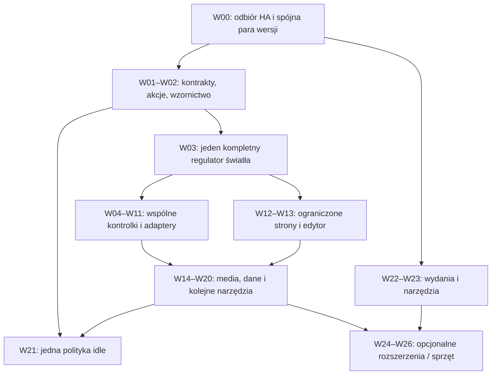

# Plan implementacji Atmosfery — 2026-10-24

Status: decyzje wykonawcze i kolejność prac, **nie deklaracja wdrożenia**. Plan pokrywa wszystkie 108 rodzin z [rejestru funkcji](feature-roadmap-2026-10-24.md). Badania i pochodzenie pomysłów są w [porównaniu projektów](../research/project-comparison-2026-10-24.md), a faktycznie wykonane testy w [rejestrze walidacji](ha-dashboard-2026-10-24.md). Istniejących funkcji nie piszemy ponownie.

Bieżący firmware: native26 / HA19, czysty układ16. Lokalizacja separatora liczbowego ma
pełny build, wgranie, odczyt ELF i trzy screenshoty PL0,25/EN0.25/PL0,25 bez
polecenia zmiany wartości. Jeden porównawczy cykl Ustawień utrzymał31 FPS bez
nieudanych klatek. Układ przywrócono z zachowaniem pozycji użytkownika; świeży
odczyt odpięcia i usunięcie dokładnego pomocnika przeszły. Poprzedni native25
obejmuje poprawkę nowej sesji, native24 — dostępność input_button. Szczegóły
i ograniczenia są w [bieżącej walidacji](validation-2026-10-25.md).
Podgląd palety w HA17 przeszedł wdrożenie i próbę zmiany/przywrócenia akcentu
bez utraty szkicu. HA18 rozszerza istniejącą dostępność na zwykłe
button/scene/script: wdrożenie, izolowana scena z rzeczywistym stanem wirtualnego
przełącznika, tłumienie disabled/held oraz cleanup i dwa porównawcze cykle
Ustawień przeszły. HA19 jest zainstalowane: Start/Pauza/Wznów timera mają test
na urządzeniu, rzeczywisty stan wirtualnego timera w HA, cztery oryginalne obrazy
i zakończony cleanup do16. Przy dopasowanym ustawieniu mikrofonu przewijanie
Ustawień utrzymuje31 kl./s; mikrofon wrócił do poprzedniego stanu. Różnica
pamięci i całkowite CPU nie są przyjęte jako wyjaśnione. HA20 z krótką godziną
najbliższego wschodu/zachodu ma lokalny kod i pakiet; wdrożenie i test ekranu
pozostają otwarte. Pełne countdown/detail i pending/error zwykłych akcji nadal
są na liście. [Bieżące dowody i granice pomiarów](validation-2026-10-26.md).

## 1. Decyzja w skrócie

Rozwijamy istniejącą integrację HA oraz natywne komponenty ESPHome. HA przechowuje układ, odkrywa możliwości encji, normalizuje dane i wykonuje akcje. Urządzenie utrzymuje ograniczoną liczbę widżetów, pokazuje bieżący stan i obsługuje gesty. Panel przeglądarkowy jest edytorem, nie serwerem konfiguracji ani właścicielem urządzeń.

Najpierw odbieramy obecną integrację w prawdziwym HA. Następnie uruchamiamy jeden kompletny regulator światła: wybór encji w HA → otwarcie szczegółów → podgląd podczas drag → jedna komenda po release → rzeczywisty stan HA → poprawny powrót do Home. Dopiero po jego pomiarach wydzielamy wspólne kontrolki i dokładamy adaptery kolejnych domen.

Kolejność produktu:

1. **Działający edytor i rzeczywiste akcje w obecnych miejscach Home.**
2. **Wspólny ekran szczegółów encji**, zamiast osobnej aplikacji i osobnego bufora dla każdej domeny.
3. **Konfigurowalne strony z ograniczonych szablonów**, po ustaleniu rzeczywistego kosztu widżetów.
4. **Historia, pogoda, kalendarz, media i powiadomienia**, z obliczeniami i historią po stronie HA.
5. **Polityka idle, wygaszacze, instalacja i narzędzia**, wykorzystujące istniejące kontrolery.
6. **Opcjonalne AI, pluginy, bogate media i inne warianty sprzętu**, jako odrębne projekty z bramką wykonalności.

Pierwsze użyteczne wydanie obejmuje W00–W04 oraz proste akcje/sensory z W01/W10. Nie czekamy na rozbudowę stron, WASM ani AI, aby zastąpić obecne atrapy. Kolejne wydania dodają małe, działające fragmenty.

## 2. Co zachowujemy i gdzie pracujemy

Punkt wyjścia to lokalny profil P0 `echo-hub-m3-v1`: 16 bindingów, 14 edytowalnych miejsc, stabilne ID i rewizje. Kod edytora ma dowody host/mock, firmware v7 ma dowody urządzenia. Instalacja w rzeczywistym HA i wykonanie usług/aktuatorów nie są jeszcze odebrane. Szczegóły, hashe i ograniczenia są w rejestrze walidacji; niniejszy plan nie zmienia tych statusów.

| Warstwa | Obecne miejsce pracy | Odpowiedzialność |
| --- | --- | --- |
| HA | `custom_components/atmosfera_echo_hub/{layout,cards,controller,panel}.py`, `__init__.py`, `services.yaml` | Model, możliwości, walidacja, kontekst uprawnień, wysyłka i lifecycle subskrypcji |
| Edytor | `custom_components/atmosfera_echo_hub/www/tile-editor.js` | Układ/inspektor, DnD, stan szkicu i konflikty; bez wywoływania urządzeń z preview |
| Produkt | `modules/lvgl/{material,navigation,theme,i18n}.yaml`, `pages/`, `modules/{player,camera,immich,weather,voice_assistant}/` | Kompozycja, wygląd, konkretne ID i reguły produktu |
| Komponenty | companion `kyvaith-esphome/esphome/components/lvgl_material/` i `lvgl/` | Maszyny stanów kontrolek, wejście, bufory, snapshots, rendering i handoff |
| Istniejące multimedia | `esp_audio_stack`, `sendspin`, `network_camera`, `esp32_jpeg`, `immich_gallery` oraz ich adaptery produktu | Zachowanie obecnej ścieżki audio, JPEG, kamer i galerii |
| Host / narzędzia | `tools/` i testy obu repozytoriów | Walidatory kontraktów, pomiary, artefakty, replay i późniejszy podgląd |

Nazwy nowych plików poniżej są **propozycjami**, nie istniejącymi API. Granice własności wynikają z [ADR](../architecture/decisions.md), [architektury HA](../architecture/home-assistant-dashboard.md) i [rozszerzania UI](extending-ui.md). Ciężka logika nie trafia do lambd YAML.

**Wspólne elementy UI:** scalar (jasność/pozycja/setpoint/number), choice (tryb/opcja), action/status/confirmation i ograniczony widok danych/listy. Aplikacja nr 6 zaczyna jako light detail, po W04 staje się jednym ekranem szczegółów dla domen sterowania. W12 może dodać aplikację nr 7 dla bounded list/chart/content, jeżeli jej koszt jest odebrany; wtedy `max_entries` rośnie 6→7, lecz `decoded_slots` nadal wynosi 1. To nie są dodatkowe raw framebuffers. Historia powiadomień, agenda i wykres korzystają z tej samej puli viewerów/wierszy; dane stronicujemy, zamiast tworzyć raw bitmapę długiej listy. Więcej scalar w widoku nadal ma jeden aktywny drag, region/worker i sesję — przełączenie geometrii przechodzi drain/rebase.

Nie przenosimy stosu GSP/Lua z Mosaico ani gotowego silnika Tessery. Inspirujemy się funkcjami i UX; reusable C++ pozostaje bez nazw Atmosfera, encji HA, pinów i stałych wymiarów produktu. Licencje i pochodzenie kodu sprawdzamy przed ewentualnym wykorzystaniem zewnętrznych fragmentów.

## 3. Zależności i koszt

Koszt oznacza względną wielkość: **S** — izolowany adapter/UI; **M** — kilka modułów i scenariuszy; **L** — nowy wspólny kontrakt/widget lub rozbudowany przepływ; **XL** — kilka pionowych fragmentów albo osobny produkt/BSP. To nie są dni ani obietnica terminu. Nie sumować kosztów funkcji, które współdzielą infrastrukturę. Blokada dostępu lub brak sprzętu nie jest czasem implementacji.

Diagram pokazuje zależności produktu, nie obowiązek pisania wszystkiego w jednym ciągu. Szczegółowa kolejność jest poniżej. W02 może dostarczać projekt i statyczne prototypy podczas oczekiwania na HA. Adaptery niezależnych domen można przygotowywać równolegle po zamrożeniu wspólnego kontraktu, lecz build/flash/urządzenie mają jednego właściciela. Nie mieszamy kilku niesprawdzonych rendererów w jednym firmware.

| Pakiet | Efekt | Wymagany fundament | Koszt | Pierwszy odebrany wynik |
| --- | --- | --- | --- | --- |
| [W00](#w00) | HA/P0: odbiór, pojedynczy writer, migracja | baza / równolegle | M | Rzeczywisty DnD → jedna akcja |
| [W01](#w01) | Katalog, kontrakt i proste działania | W00 | L | Uczciwy stan i typowane akcje |
| [W02](#w02) | M3, role, teksty i rejestracja | baza / równolegle | M | Jedna wspólna specyfikacja UI |
| [W03](#w03) | Pierwsza kontrolka: światło | W01, W02 | L | Jasność end-to-end na urządzeniu |
| [W04](#w04) | Scalar/session po dowodach + number | W03 | M | Druga domena bez drugiego silnika |
| [W05](#w05) | Cover i tilt | W04 | M | Open/Stop/Close i pozycja |
| [W06](#w06) | Fan i choice/select | W04 | M | Opcje i speed w jednym detail |
| [W07](#w07) | Climate i humidifier | W04, W06 | L | Setpoint → mode → dual range |
| [W08](#w08) | Barwa i efekty światła | W03, W06 | L | Color temp → effects → RGB |
| [W09](#w09) | Lock/alarm oraz lokalny PIN | W01, W02, W06 | L | Jawna kontrola i odrębna blokada |
| [W10](#w10) | Sensory, binary, zegar i formaty | W01, W02 | M | Prawdziwe dane zamiast statycznych liczb |
| [W11](#w11) | Timer i słońce | W04, W10 | M | Odliczanie niezależne od renderowania |
| [W12](#w12) | Strony/szablony i admission | W00, W02, W04 | XL | Pierwsza dodatkowa strona, potem limit profilu |
| [W13](#w13) | Grupy, wiele urządzeń i appearance | W12 | L | Atomowe kopiowanie i identify |
| [W14](#w14) | Media player i biblioteka | W04, W06 | L | Sterowanie wybranym playerem; potem browse |
| [W15](#w15) | Kamera, doorbell, Gallery i miniatury | W01, W12 | L | Doorbell wcześniej; karty obrazu po W12 |
| [W16](#w16) | Akcje/obrazy i historia powiadomień | W01, W12, W15 | L | Akcje wcześniej; potem centrum historii |
| [W17](#w17) | Historia, gauges, energia, prognoza | W10, W12 | L | Statyczny wykres/prognoza przed animacją |
| [W18](#w18) | Agenda, osoby i mapy | W15, W17 | L | Read-only agenda/osoba przed booking/mapą |
| [W19](#w19) | Vacuum/mower/remote | W04, W06 | M–L | Standardowe akcje; mapy dopiero po W18 |
| [W20](#w20) | Local/HTTP/guest QR | W01, W15 | M | Local/HTTP wcześniej; QR po ochronie transportu |
| [W21](#w21) | Idle, harmonogram, theme i savery | W02, W10, W16 | L | Jedna tabela priorytetów i jeden aktywny widok |
| [W22](#w22) | Wydania, recovery i migracja profili | W00 | L–XL | Manifest/rollback od początku; C6 i profile osobno |
| [W23](#w23) | Workbench, host preview i build queue | W00, W22a | XL | Obecne narzędzia → host → WASM → flota |
| [W24](#w24) | Pakiety, AI, reguły, MCP i agent | W13, W22a, W23a | XL | Sześć osobnych decyzji/podetapów |
| [W25](#w25) | Audio kamery, GIF/radar, spectrum | W14, W15, W21 | XL | Trzy niezależne eksperymenty, domyślnie off |
| [W26](#w26) | BSP i warianty sprzętowe | W22a i recovery docelowego BSP | spike → XL | PoC/egzemplarz i osobny profil, albo odłożenie |

Zależność oznacza odebrany fundament wymagany przez dany fragment, nie wszystkie późniejsze warianty poprzedniego pakietu. Najpierw W01a: istniejące metadane, fixtures i minimalny kontrakt; generator W01b dopiero po dwóch konsumentach W03/W04. Podstawowy manifest/rollback W22a powstaje od początku; migracja W22d czeka na osobno odebrany profil W26, podczas gdy W26 potrzebuje tylko W22a i recovery swojego BSP. Nie ma pętli „najpierw całe recovery wszystkich płyt”. W23a opakowuje obecne narzędzia, W23b/c/d dodają host renderer/WASM/flotę; AI nie czeka na całą flotę. Podstawowe operacje W19 nie czekają na mapę W18. To nie jest kalendarz ani jedna gałąź z 27 jednoczesnymi zmianami.

## 4. Pakiety wykonawcze

### W00. Odebrać obecną integrację, nie budować drugiej

- **Działanie:** zainstalować przygotowaną parę HA/P0, zachować options/eksport i znany dobry firmware, ustalić jednego aktywnego nadawcę układu. Otwarty stary edytor lub stara instancja HA nie może po cichu degradować nowego dokumentu.
- **Kod:** istniejące `__init__.py`, `controller.py`, `panel.py` i instalacja; dokończyć celowane testy rzeczywistego HA. Obecny `panel.py` odrzuca legacy `tiles/save` dla v3 błędem `incompatible_editor`, zachowując dokument kontrolek; wersjonowany `layout/save` sprawdza `expected_revision`. Historyczny interfejs v2 nadal nie ma klienckiego `expected_revision`, więc bramkę starych/równoległych klientów trzeba sprawdzić w jej rzeczywistym zakresie, bez przypisywania jej własności nowszego edytora.
- **Odbiór:** zalogowany administrator zapisuje układ, karta jest przeciągnięta między stronami, jej ID pozostaje stałe, dokładnie jedna dozwolona usługa jest wykonana, restart/reconnect HA zachowuje układ. Test konta bez wymaganych uprawnień, dwóch edytorów i starego klienta. Rzeczywisty stan i zachowanie aktuatora zapisujemy osobno.
- **Stan:** dostęp do HA i konfiguracji został uzyskany; HA12 ma osobny rzeczywisty odbiór edytora, zachowany wpis/options i pełną zgodność źródeł. Nie wymaga to nowego add-onu. Nadal otwarte są odpowiednie bramki urządzenia, uprawnień/równoległych klientów i aktuatora. Historyczny konflikt z legacy writerem pozostaje zachowanym dowodem; nie zastępujemy go domniemanym „spokojnym oknem”.

### W01. Ujednolicić możliwości, sesję poleceń i proste akcje

- **Działanie:** doprowadzić istniejące switch/light/input_boolean, scene/script/button, input_button, automation i trigger do pełnego przepływu pending/result/unavailable. Nie zastępować każdego tap własnym nieograniczonym RPC.
- **Kod:** `cards.py` i `layout.py` pozostają punktem wyjścia. Udostępnić ich metadane edytorowi, dodać wspólne fixtures i minimalny kontrakt sesji; generator tabel wprowadzić dopiero przy dwóch rzeczywistych konsumentach. Pierwszą sesję posiada proponowany `light_control.py` w W03; dopiero W04 wydziela wspólny `control_session.py` i adaptery po dowodach światła. Reusable `material_entity_control.*` zna kontrolki i action IDs, nie nazwy usług HA; nie powstaje z góry framework wszystkich domen.
- **Semantyka:** channel połączenia + otwarcie + token selekcji + ID/revision + sekwencja komendy. Ten sam retry nie wykonuje usługi ponownie; konflikt treści, stara sesja i spóźnione release są odrzucane. Obsłużyć brak HA, timeout, usunięcie encji/usługi i utratę capability. Korelacja nie zastępuje uwierzytelnienia transportu ani uprawnień HA.
- **Status:** pokazywać saved/sent/source-accepted oraz gotowość widocznej strony. Off-window może legalnie czekać. Ewentualny nowy ACK prezentacji musi pochodzić z konkretnej generacji/callbacka właściciela; nie nazywać go dowodem fizycznego scanout ani stanu lampy. Nie ustawiać `applied=true` po samym RPC.
- **Odbiór:** jeden rzeczywisty service call i uczciwy feedback; duplicate/reorder/unload/reconnect nie wykonują dodatkowej akcji. Stan encji potwierdza HA, nie powrót z funkcji usługi.

### W02. Wspólny język wizualny i lokalizacja

- **Działanie:** opisać role kolorów, rozmiary, typografię, kształty, pressed/pending/error/disabled oraz krótkie przejścia M3 Expressive. Zachować obecny okrągły Home i zaakceptowany zegar.
- **Kod:** `theme.yaml`, `i18n.yaml`, `fonts.yaml`, pakiety językowe i reusable Material. Wykorzystać istniejący akcent i tłumaczenia HA; własne teksty en/pl tylko dla braków. **Przed tłumaczeniem Voice** oddzielić typowany identyfikator fazy od tekstu: obecny `material_voice_assistant.cpp` rozpoznaje fazę z angielskiego display text. Najpierw kompatybilny refaktor z testem phase/animacji, potem lokalizacja; ikona języka jako osobna poprawka. Nie zastępować po prostu angielskiego stringa polskim.
- **Odbiór:** macierz en/pl × jasny/ciemny akcent × pending/error/disabled, długie nazwy, tekst czarny/biały i screenshot po zmianie motywu oraz przy zamykaniu aplikacji. Ukryte Lottie nie pracują; nie dodajemy animacji, która wymusza pełny redraw co tick.

### W03. Światło jako pierwszy pełny regulator

- **Działanie:** jawna opcja „sterowanie światłem”, aplikacja szczegółów nr 6, On/Off, jasność i rzeczywisty stan. Istniejący default tap nie zmienia znaczenia po aktualizacji.
- **Kod:** wdrożyć [szczegółowy plan światła](p1-light-brightness-plan-2026-10-24.md), z lżejszym wariantem regionalnym przyjętym w sekcji 7 poniżej. W trakcie drag pokazujemy lokalny kandydat w rail/value bubble; duża wartość natywna aktualizuje się na granicy stanu/release, nie co piksel.
- **Odbiór:** dimmable i on/off-only, 0/1/100, ruch bez release, cancel, zanik encji, zmiana układu przy trzymaniu, reopen/Voice/sleep, opóźniony wynik. Jedna zmieniona interakcja release = jedna komenda. Najpierw pomiar tej jednej kontrolki, potem uogólnienie.

### W04. Wydzielić sprawdzony scalar i dodać number

Stan lokalny 2026-10-25: wspólny właściciel sesji i jawny stepper
`input_number` działają w HA14/native23 bez drugiego renderera. Przeszły39 testów
native/481 subtestów,301 HA i209 edytora oraz pełny build/audit/OTA/ELF23.
Native22 ma dodatnią izolowaną próbę0→0.25 ze stanem HA i oryginałami; native23
potwierdza polski panel/open-close i pogodę po boot-locale fix. Izolowane Light
Off/On/jasność60 przeszło native, końcowy observer HA i odbiór oryginałów.
Osobna próba granic Number i kroków1→0.75/−1→−0.75 przeszła native/HA/original;
dwa Settings benchmarki dały31FPS/failed0 i stabilne free, z odzyskaniem largest.
Końcowy układ6 przywraca tylko sześć pól QA, zachowując DnD użytkownika; cztery
fixture usunięto. Hold/zmiany domeny, fizyczny GT911, audio i lifetime pozostają
osobnymi bramkami; nie ma fizycznej lampy za dawną
encją W03. Bieżące dowody: [dziennik walidacji](validation-2026-10-25.md).

- **Działanie:** po W03 przenieść sprawdzony renderer/sesję do wspólnego mechanizmu bez zmiany zachowania; dopiero w osobnej zmianie dodać `number/input_number`.
- **Kod:** generic scalar ma min/max/step/unit/null, lokalny kandydat, jeden aktywny pointer i cancel. HA kwantyzuje i waliduje względem aktualnego opisu encji; C++ nie zna `number.set_value`. Wspólny ekran szczegółów wykorzystuje te same widżety i region.
- **Odbiór:** liczby ujemne, ułamkowy step, granice, jednostka, unknown, zmiana zakresu podczas drag; brak wysyłki kandydata po cancel. Refaktor ma ten sam obraz i wyniki co W03 przed dołożeniem domeny.

### W05. Rolety i bramy

- **Działanie:** osobne Open/Stop/Close, pozycja i tilt tylko przy wsparciu encji; Stop dostępny podczas ruchu.
- **Kod:** adapter cover w HA, dwa scalar opisy oraz wspólny zestaw przycisków. Wyeliminować zgadywanie kierunku z generic toggle. Nowa komenda zachowuje aktualny kontekst, a przerwanie UI nie wysyła automatycznej komendy odwrotnej.
- **Stop:** jest jawnym negocjowanym wyjątkiem od jednej zwykłej pending komendy. Nie czeka na 5+8-sekundowe okno potwierdzania stanu i nie jest disabled razem z pozycją. Dopuścić jeden pilny Stop, anulować niewysłany ruch i zastąpić obserwację starego wyniku; blokada dispatch nie obejmuje długiego oczekiwania na stan. Zachować kolejność wobec już rozpoczętej usługi, aby stary ruch nie został wysłany po Stop. Spóźniony wynik nie przywraca ruchu/statusu. Brak nieograniczonej kolejki lub automatycznego retry.
- **Odbiór:** znana/nieznana pozycja, opening/closing, Stop podczas pending i powolnej usługi, brak tilt, zmiana capability i usunięcie encji. Rzeczywisty ruch/stop i kolejność integracji testować na wskazanym urządzeniu; samo odebranie RPC nie dowodzi zatrzymania.

### W06. Wentylator i wybór opcji

- **Działanie:** speed/oscillate/direction/preset oraz `select/input_select`. Zamiast kolejnych aplikacji dodać drugi wspólny prymityw: bounded choice/list.
- **Kod:** HA przekazuje dozwolone opcje i ich stabilne IDs; pierwszy picker ma **do ośmiu ponownie używanych wierszy i paginację** oraz jedną selekcję. Dane strony opcji mają osobny bounded odczyt do 8 KiB; komenda pozostaje w 2 KiB. Płynny scroll wymaga osobno zmierzonego regionalnego/snapshotowego rozwiązania — nie native LVGL pełny redraw na każdy ruch ani raw bitmapa nieograniczonej listy. Bieżąca lista może się zmienić — stara opcja nie jest wysyłana.
- **Odbiór:** 0/100% oraz krok wentylatora, on/off-only, długie/opróżnione listy, zmiana opcji przy otwartym pickerze; jedna komenda na zatwierdzenie.

### W07. Climate i humidifier

- **Działanie:** najpierw jeden setpoint i HVAC mode; potem dual range, fan/swing/preset; następnie humidifier korzystający z tych samych scalar/choice.
- **Kod:** adaptery HA liczą zakresy, jednostki i poprawne kombinacje low/high; jedna aplikacja szczegółów, maksymalnie jeden aktywnie przeciągany region. Nie dodawać ładnej tarczy bez pełnej semantyki.
- **Odbiór:** heat/cool/off/auto, odwrócone/przekraczające zakresy, °C/°F, zmiana min/max, niedostępna encja. Sztuczna wartość „22” nie może zastąpić unknown.

### W08. Barwa i efekty światła

- **Działanie:** po jasności kolejno temperatura barwowa, lista efektów, potem RGB/HSV. Model możliwości decyduje, co jest dostępne.
- **Kod:** jeden ograniczony picker koloru i scalar temperatury w tym samym ekranie; interpolację palety przygotować raz, nie generować pełnoekranowej bitmapy na każdy ruch. HA wybiera usługę i format z aktualnych color modes.
- **Odbiór:** dimmable-only, color-temp-only i RGB; min/max temperatury, wycofane efekty, mało nasycone kolory, cancel i zmiana źródła podczas drag. Preview koloru nie steruje lampą przed zatwierdzeniem.

### W09. Lock, alarm i lokalny PIN

- **Działanie:** rozdzielić zwykły status, jawnie dozwoloną akcję, potwierdzenie oraz ewentualny kod. Lokalna blokada ekranu to osobny mechanizm, nie zamiennik autoryzacji HA.
- **Kod:** HA adaptery nadal decydują o lock/arm/disarm i wymaganiach usługi. Proponowany wspólny confirmation/keypad nie zapisuje kodu w layout, eksporcie, logach ani snapshotach. Lokalny PIN ma osobny model przechowywania weryfikatora i rate-limit prób; kodem blokady ekranu nie zastępujemy kodu alarmu. Sekrety i komendy dostępu wymagają ustalonej ochrony transportu; obecne źródła nie dowodzą szyfrowania API.
- **Odbiór:** missing/wrong code, brak uprawnień, retry, unavailable, relock/wygaśnięcie, powiadomienie przy blokadzie. Domyślnie brak automatycznego unlock/disarm. Akcje rzeczywiste tylko w uzgodnionym scenariuszu.

### W10. Sensory, obecność, zegar i formatowanie

- **Działanie:** zamienić statyczne teksty na prezentację rzeczywistych encji; precision/unit/duration i device class decydują o opisie i ikonie.
- **Kod:** formatowanie i state mapping w HA; firmware otrzymuje bounded tekst, rolę i ważność. Zegar lokalny odlicza względem zsynchronizowanego czasu, nie zależy od push co sekundę. Warianty digital/analog/dial/flip dodawać pojedynczo; sekundy opcjonalne i regionalne.
- **Odbiór:** binary_sensor door/window/motion/presence, unknown/unavailable, długie jednostki i nazwy, DST, zmiana strefy, 12/24h. Nie przebudowywać przy tym obecnego dobrze wyglądającego zegara.

### W11. Timer i dane słońca

- **Działanie:** start/pause/resume/cancel oraz poprawne lokalne odliczanie; karta słońca jako rzeczywisty model, później statyczny wykres ścieżki.
- **Kod:** HA jest autorytetem czasu zakończenia/zdarzenia, firmware liczy pozostały czas monotonicznie i resynchronizuje po reconnect. Mały region licznika, bez pełnego odświeżania 30–60 razy/s.
- **Odbiór:** pauza, restart HA/ESP, upływ w tle, zmiana czasu systemowego i brak źródła. Reconnect nie uruchamia timera ponownie.

### W12. Ograniczone strony, szablony i budżety

- **Działanie:** najpierw reorder/hide istniejących stron, potem nowe strony z małego zestawu zwalidowanych układów. Resize wybiera dostępny wariant szablonu; nie jest dowolnym rozciąganiem LVGL.
- **Kod:** nowa wersja modelu/layout wire i zaufanego profilu; opis geometrii, kolizji i kosztu w HA oraz admission w C++. Proponowany pierwszy limit: **6 stron Home łącznie**, **32 bindingi łącznie**, w tym dwa legacy hidden, czyli najwyżej 30 edytowalnych kart. Home/Apps pozostają zarezerwowane. Pula obiektów/rootów powstaje w setup; JSON zmienia zwalidowane przypisanie/geometrię na tasku właściciela, nie tworzy dowolnego drzewa. To limit do pomiaru, nie obecna funkcja.
- **Zmiana strukturalna:** obecne maski/status/pool produktu dla 16 slotów wymagają spójnego rozszerzenia do 32 bitów, a nie tylko większego JSON. Sprawdzić bit31 także w JS, gdzie operacje bitowe mogą dać ujemny wynik. Każdy root, wskaźnik, subpage/back i cel nawigacji musi być zarejestrowany. Stan skrótu i jego action target są osobne; cykle relacji są błędem. Home nadal ma trzy raw slots; dalsze strony JPEG z limitem łącznego backing.
- **Odbiór:** przejścia przez każdą granicę/ostatnia→pierwsza, dotyk w settle, zmiana danych niewidocznej strony, usunięcie aktualnej strony, błędne/zbyt drogie układy, zdalny cel podczas gestu. Odrzucenie jest atomowe i wyjaśnia koszt/niezgodność.

### W13. Zaawansowany edytor i wiele urządzeń

Wdrożony ograniczony wycinek HA12: zaznaczanie istniejących edytowalnych kart,
grupowe Pokaż/Ukryj/Usuń, kopiowanie z jawną mapą osobnych pustych miejsc,
Cut/Move z zamianą miejsc wewnątrz grupy i grupowa paleta, wyłącznie w szkicu HA.
Modal wyglądu obejmuje do 14 wybranych kart i pięć istniejących semantycznych
palet. Początkowe „Nie zmieniaj” blokuje zatwierdzenie. Pełny CAS źródeł/kontekstu
poprzedza zmianę wyłącznie palety po ID w bieżącym szkicu; jedno Undo cofa całość,
a ta sama wartość nie zmienia historii/dirty/redo. Cancel zachowuje wybór/fokus,
Escape kończy wybór; natywny SELECT uczestniczy w Tab/Shift+Tab. 200 Node
(181 bez zmian +19) i 250 HA shim PASS; rzeczywisty HA12, osiem oryginałów i
180-sekundowy explicit selected-light observer:0, bez Save/akcji encji. Naturalny
wait zachował DOM/fokus, ale nie dowodzi pojedynczej odpowiedzi poll. Korzysta z obecnego profilu,
nie rozszerza stron, slotów ani protokołu. Jedna operacja grupy ma jeden Undo;
Save nadal wymaga jawnej akcji i zgodnej rewizji. Ten wycinek nie zastępuje
W12 ani odbioru W03 i nie kończy importu grupy lub wielu urządzeń.
Rzeczywisty test szkicu, klawiatury i jednego Undo opisuje bieżący
[rejestr wdrożenia](live-ha-deployment-2026-10-24.md). Poprawka kontrastu napisu
usuwania została sprawdzona w rzeczywistym ciemnym motywie HA10.

- **Działanie:** multiwybór, copy/cut/paste i przenoszenie między istniejącymi stronami; następnie między zgodnymi urządzeniami. Dodać identify/profile/version i bogatsze appearance.
- **Kod:** jedna transakcja undo dla grupy, collision check na profilu docelowym, nowe ID przy kopiowaniu i zachowane ID przy przenoszeniu w tym samym dokumencie. Wspólny katalog ikon z profilem glyph coverage; brak runtime pobierania nieograniczonych fontów na ESP.
- **Odbiór:** konflikt rewizji nie zapisuje połowy grupy, utrata połączenia nie gubi szkicu, kopiowanie nie dubluje tożsamości, telefon/klawiatura/realny dotyk i maska okrągłego ekranu.

### W14. Media player i biblioteka

- **Działanie:** karta dowolnego HA media_player z capabilities, potem browse/favourites/speaker picker. Istniejący lokalny Player, Sendspin, grupy i volume pozostają właścicielami swoich ścieżek.
- **Kod:** HA adapter do sterowania wybranym odtwarzaczem i bounded stronicowanie mediów; wspólny ekran kontroli lub świadomie wybrana istniejąca aplikacja Player. Oddzielić „steruję zewnętrznym playerem” od „odtwarzam tutaj”. `media_source` udostępnia media, lecz nie transkoduje ich za nas; format musi obsługiwać odbiornik. [Dokumentacja HA](https://www.home-assistant.io/integrations/media_source/).
- **Odbiór:** play/pause/seek/volume/source tylko gdy wspierane, nieznany duration/position, znikający player, duża biblioteka. Osobno ciągłość lokalnego Sendspin i sterowanie urządzeniem zewnętrznym; listy nie zmieniają właściciela I2S.

### W15. Kamera, doorbell i źródła galerii

- **Działanie:** najpierw doorbell otwierający istniejącą kamerę i przywracający poprzedni kontekst; potem miniatury/Fit/Fill; następnie kolejne źródła zdjęć.
- **Kod:** istniejące `camera_proxy.py` i allow-list HA, `network_camera`/JPEG/Camera lifecycle oraz Gallery/Immich. Dla nowych źródeł HA/host normalizuje katalog i obrazy do wspieranego formatu; nie powielamy galerii. Pierwszy slice to jedna **statyczna miniatura LVGL 160×160**, odświeżana po otwarciu/TTL, bez direct workera przed wykazaniem potrzeby pomiarem. Osobna mała pula ma current i staging po 76800 B, encoded input do 64 KiB oraz 8 KiB stanu: 227328 B przed overhead, proponowany cap puli 256 KiB. Decode trafia wyłącznie do nieużywanego staging; po zakończeniu/cache sync właściciel LVGL atomowo publikuje descriptor. Stary current można odzyskać dopiero po zakończeniu odczytów renderera/snapshotów; przy braku bezpiecznego staging pomijamy/koalescujemy refresh, zamiast alokować trzeci bufor. Stara miniatura pozostaje do sukcesu, a nieaktualna generacja jest odrzucana. Właściciel oznacza właściwy Home snapshot jako dirty i odświeża go według istniejącego lifecycle, bez powtarzanego `lv_refr_now()`. Każda miniatura ma TTL, generation i backoff; nowy typ karty wymaga jawnego slotu obrazu w profilu/puli W12. Więcej jednoczesnych obrazów wymaga osobnego budżetu i dowodu coherent backing. Nie zmieniamy kontraktu jednego decoded frame istniejącego strumienia Camera.
- **Odbiór:** wolny start proxy, zerwanie strumienia, wygasły URL, doorbell w Voice/Gallery/sleep/lock, dwa zdarzenia i powrót. Mierzyć presents kamery, nie sam decode FPS. Nie budować raw 800×800 per miniatura.

### W16. Powiadomienia i centrum

- **Działanie:** zachować istniejącą kolejkę czterech powiadomień; dodać typowane action IDs, opcjonalny obraz i historię po stronie HA.
- **Kod:** rozszerzyć `notify.py`/`material_notification.*`, dołożyć stronicowane centrum w tym samym bounded viewerze treści. Callback wybiera dozwoloną akcję w HA i nie ma dowolnego kodu/usługi z ESP. Urządzenie pobiera tylko bieżącą stronę historii. Pierwsza proponowana retencja HA: do 100 metadanych/24 h, osiem na stronę; obrazy/sekrety nie tworzą bezterminowego archiwum. TTL i czyszczenie są częścią modelu.
- **Odbiór:** powtórzone/spóźnione kliknięcie, kolejka pełna, zanik sieci, usunięta akcja, obraz za duży i overlay podczas drag/kamery. Zamykanie nie wykonuje akcji, obraz jest zwalniany po drain.

### W17. Historia, mierniki, energia i prognoza

- **Działanie:** najpierw statyczna mini-historia sensora i prognoza, potem wykres szczegółowy i energia, na końcu opcjonalny ruch mierników.
- **Kod:** proponowany adapter `content_data.py` w HA agreguje/decymuje do 128 punktów na krzywą i najwyżej dwóch krzywych na widok; punkty braku danych są przerwą. Nie czytać bazy Recorder bezpośrednio z ESP. Mały reusable chart/gauge i jedna aktywna strona danych; energia korzysta z rzeczywistych jednostek i statystyk HA.
- **Prognoza:** adapter używa wspieranego API HA, np. `weather.get_forecasts` po sprawdzeniu możliwości zainstalowanej wersji, i ogranicza widok do 7 dni/24 godzin. Nie przepisywać dziewięciu obecnych scen Lottie. [Dokumentacja HA](https://www.home-assistant.io/integrations/weather/).
- **Odbiór:** brak luk udawanych jako zero, zmiana jednostki, stare/niepełne dane, reconnect i zły zakres. Wykres nie odświeża się częściej niż zmieniają się dane; wszystkie punkty i bufory mają limit.

### W18. Kalendarz, osoby i mapy

- **Działanie:** agenda i stan osoby/strefy najpierw; dzień/tydzień/miesiąc, zdjęcia i mapa dopiero po ich odebraniu. Rezerwacje dopiero dla integracji z rzeczywistą usługą zapisu.
- **Kod:** HA ogranicza okno zdarzeń i stronicuje, firmware ma stałą pulę komórek/wierszy. Atrybut „następne zdarzenie” nie jest agendą wszystkich wydarzeń. [Dokumentacja HA](https://www.home-assistant.io/integrations/calendar/). Proponowany pierwszy limit: 32 zdarzenia/7 dni na odpowiedź, 8 widocznych wierszy; dalsze dane pobierane na żądanie.
- **Mapy:** osobny provider po stronie HA/host, ograniczony raster/overlay z określonym zoomem; nie pełny silnik map kafelkowych na P4. Klucz providera pozostaje po stronie serwera.
- **Odbiór:** all-day/DST/overlap, pusta agenda, usunięcie zdarzenia, odrzucona rezerwacja, person unavailable, stary obraz/mapa i brak providera. Potwierdzenie zapisu pochodzi z HA.

### W19. Vacuum, mower i remote

- **Działanie:** standardowe start/pause/stop/dock oraz power/activity/command keypad, później vendor-specific pokoje/routines i mapy.
- **Kod:** adaptery HA do wspólnych action/choice; lista komend i pokoi pochodzi z rzeczywistych możliwości wybranej integracji. Nie wysyłać protokołu producenta z ESP ani nie zgadywać nazw komend. Mapa wykorzystuje ograniczony renderer/provider W18.
- **Odbiór:** unsupported feature, urządzenie zajęte/unavailable, zmiana listy pokoi, timeout i retry. Podstawowe funkcje mogą zostać wydane bez mapy; część vendor-specific pozostaje jawnie niedostępna.

### W20. Lokalne akcje, webhook i guest QR

- **Działanie:** katalog prekompilowanych lokalnych możliwości ESPHome, jawny bezstanowy trigger oraz konfigurowalne akcje HTTP realizowane w HA.
- **Kod:** lokalny callback jest wybierany z allow-listy, nie przesyłany jako lambda. URL/metoda/parametry HTTP i tajne nagłówki należą do adaptera HA; urządzenie wysyła action ID. QR sieci gościnnej generowany jest na żądanie, ma krótki lifecycle i nie trafia do zwykłego eksportu/historii powiadomień. Sekretny widok nie zostaje normalnym app preview: przed capture/close maskujemy QR, drainujemy jego źródło i unieważniamy wcześniejsze backing; potwierdzić brak kodu również w kolejnej animacji/screenshotach.
- **Odbiór:** nieistniejący callback, duplikat triggera, błąd/timeout HTTP, błędne UTF-8 QR i brak konfiguracji sieci. Nie przełączać łączności urządzenia przy samym otwarciu karty Wi-Fi. Sekretny payload wymaga zweryfikowanej ochrony transportu.

### W21. Jedna polityka idle i wygaszaczy

- **Działanie:** wspólna decyzja o jasności, auto-Home, obecności, harmonogramie/solar, motywie i sekwencji clock/media/photos/camera.
- **Kod:** istniejące polityki jasności/sleep/navigation są punktem wyjścia; reusable controller ma wejścia/podsumowanie stanu, produkt deklaruje priorytety. Nie uruchamiać osobnego schedulera dla każdego wygaszacza. Ruch/odrysowanie ekranu nie liczy się jako aktywność użytkownika.
- **Priorytety:** aktywny gest musi się bezpiecznie zakończyć; Voice zachowuje pierwszeństwo zasobów audio; jawny użytkowy kontekst i polityka blokady mają pierwszeństwo nad obecnością, nocą i idle. Doorbell/powiadomienie podlega osobnej regule preemption i powrotu. Wygaszacz korzysta z istniejącego Player/Gallery/Camera, nie nowej kopii surowej klatki.
- **Odbiór:** noc→dotyk→idle, zanik presence, DST, Voice przy saverze, dwie polityki jednocześnie i powrót do właściwej strony. Warianty Glass/Classic/Bauhaus/flip mają osobny limit renderowania; blur/tła przygotować raz, sekundy domyślnie wyłączone.

### W22. Instalacja, backup i recovery

- **Działanie:** W22a to spójny manifest/backup/rollback par HA/firmware i istniejące stable/beta/OTA, potrzebne od pierwszego wydania. W22b dodaje instalator USB/web i reset, W22c osobno C6, W22d migracje między faktycznie odebranymi profilami. Nie czekamy na całe W22, aby wydać prostą kontrolkę.
- **Kod:** artefakty factory/OTA/ELF, wersje schematów/profili i checksums; backup układu bez sekretów. Migracja między profilami to raport zgodności/świadomy wybór, nie ciche ucięcie kart ani skalowanie wszystkiego.
- **C6:** osobny subetap po ustaleniu wersji i procedury recovery, z fizycznym dostępem/logiem wymaganym dla tego procesora. Nie mieszać aktualizacji radia z wydaniem nowego widgetu.
- **Odbiór:** update przerwany, rollback zgodnej pary, odtwarzanie options po cofnięciu modelu, niewspierany profil i factory reset. Cross-profile dopiero gdy drugi profil ma własny odbiór W26.

### W23. Workbench, preview i kolejka buildów

- **Działanie:** W23a zbiera obecne logi/screenshots/replay w jeden hostowy interfejs, W23b dodaje wspólny renderer host, W23c WASM, W23d flotę/remote build. Pierwsze narzędzie nie czeka na ostatni podetap.
- **Kod:** wykorzystać obecne narzędzia i adapter platformy dla native rendererów; platformowe DSI/PPA/JPEG/audio pozostają sprzętowe. Kolejka buildów ma jednego właściciela SDK/build directory oraz jawne source/image manifesty; nie uruchamiać kilku kompilacji w tym samym drzewie.
- **Odbiór:** identyczny model/tekst/geometria host–native, wersjonowany replay, brak sekretów w eksportowanym logu, przerwany build, odtworzenie dokładnego artefaktu. Preview nigdy nie zastępuje flash/hash/screenshot/physical/audio testu.

### W24. Rozszerzenia, AI i reguły

- **Działanie:** sześć oddzielnych podetapów: (a) katalog zwalidowanych deklaratywnych szablonów; (b) generowanie szkicu przez model na hoście; (c) MCP adapter na hoście/HA; (d) agent/sesje/pamięć hosta; (e) ograniczone reguły offline, jeśli istnieje realny przypadek bez HA; (f) dopiero osobny projekt natywnego ABI/pluginów.
- **Kod:** wszystkie wyniki modelu przechodzą zwykły walidator i podgląd, nigdy `eval` na urządzeniu. HA automations są domyślnym silnikiem reguł. Natywne pakiety wymagają własnego ABI, budżetów, instalacji/uninstall i recovery; nie dokładamy interpretera Lua/LLM do ścieżki audio.
- **Odbiór:** wadliwy/niedozwolony wynik, odinstalowanie podczas aktywnego widoku, offline i rollback. Model/agent nie dostaje szerszych uprawnień niż zwykły użytkowy przepływ. Każdy podetap ma osobną decyzję, a nie jeden wielki PR.

### W25. Bogatsze media — dopiero po pomiarach

- **Działanie:** trzy niezależne eksperymenty: audio kamery, GIF/radar/dodatkowe obrazy oraz wizualizacja muzyki. Żaden nie jest wymagany do dobrego Home.
- **Kod:** HA/host normalizuje formaty; firmware ma ograniczony input/canvas i drop-late. Audio kamery wchodzi do istniejącego miksowania; nigdy nowy właściciel I2S. Spectrum wykorzystuje istniejące dane/lekki tap bez blokowania audio; render tylko w widocznym regionie.
- **Odbiór:** równoczesny Sendspin/Voice, nierówne klatki, ogromny GIF, zamknięcie/zmiana motywu, pamięć i brak ukrytego dekodowania. Wariant odrzucony, jeśli pogarsza ciągłość audio lub ownership; brak CPU full-frame fallback jako trwałej „optymalizacji”.

### W26. Warianty sprzętowe — osobne bramki wykonalności

- **Kolejno:** inventory BSP/pinów/USB/I2S i fizycznych układów → mały PoC → pomiary zasilania/RAM/transportu → profil → dopiero integracja produktu. Nie wszystko z tej grupy wymaga nowej płytki, ale każde wymaga osobnego udowodnienia możliwości.
- **Zakres:** A2DP potrzebuje BR/EDR, którego nie doda opcja na obecnym P4/C6; topologia magnetyczna i hot-plug wymagają fizycznych złączy/układów; IMU/haptics/bateria oraz lokalna kamera wymagają rzeczywistych elementów i profilu. Matter/Thread oraz USB HID/UAC/secondary display to osobne ścieżki firmware/host i zgodności. Inny panel/rotacja wymaga własnych testów renderera.
- **Odbiór:** rzeczywisty sprzęt, recovery, hot-plug/zasilanie i powtarzalne testy; nowy profil ma osobny known-good image. Pozycje bez układów lub dostępu pozostają „odłożone — wymaga sprzętu”, nie atrapą w ustawieniach.

## 5. Wersjonowanie i migracje

| Moment | Propozycja | Reguła wdrożenia |
| --- | --- | --- |
| Teraz | HA layout v2, profil m3-v1, presentation wire v1 | Odebrać W00, bez zmiany semantyki istniejących tapów |
| Pierwsza kontrolka | Layout v3 z jawnym `kind: control`; wire v1 tylko z negocjowaną capability | Migracja zachowuje ID/slot/akcję; stary firmware pokazuje brak wsparcia, nie wykonuje toggle zamiast kontrolki |
| Strony runtime | Layout v4, profil m3-v2, strukturalny wire v2 i maski 32-bit | Nowy profil/pula, pełna walidacja przed aktywacją przypisania prealokowanych obiektów, brak częściowej instalacji |
| Kolejne urządzenia | Jawna tabela zgodności i migrator backupu | Konwersja wyłącznie pomiędzy naprawdę wspieranymi profilami; użytkownik widzi utracone/niezgodne możliwości przed zapisem |

Numery przyszłych wersji są propozycją do zamrożenia z fixtures przed kodem, nie wdrożonym protokołem. Model po stronie HA jest trwały; firmware dostaje bieżący bounded projection. Layout v3/v4 nie może zostać zapisany starą ścieżką, która utraci nowe pola.

Każdy rollout: eksport poprzednich options → zachowanie zgodnego pakietu HA i OTA/ELF → negocjacja capabilities → migracja dokumentu → walidacja całości → zastosowanie nowego źródła → odebranie widocznej strony. Przy błędzie zachować ostatni dobry układ. Cofnięcie wersji wymaga pasujących options i pary HA/firmware; nie cofa automatycznie wykonanych już akcji rzeczywistych urządzeń.

## 6. Kontrakty i ograniczanie danych

Poniższe nowe limity są **proponowanymi punktami startowymi**, do zatwierdzenia w danym pakiecie. Nie są aktualnymi capabilities urządzenia.

| Dane | Pierwsza granica |
| --- | --- |
| Kontekst/komenda kontrolki | 2048 B UTF-8, jedna selekcja i jedna zwykła in-flight; W05 dodaje negocjowany bounded Stop bez czekania na wynik ruchu; brak dowolnej usługi/URL/kodu |
| Obecny layout/projekcja | Zachować obecne 32 KiB, 16 bindingów do W12; nie zwiększać limitu przy samym dołożeniu adaptera |
| Nowy layout stron | Do 32 bindingów/6 stron przy W12; parser/maski/wersje zmieniają się razem, dodatkowy rozmiar payloadu tylko po pomiarze |
| Wykres | 128 punktów × maks. 2 serie, luka jako brak; render tylko aktywnego widoku |
| Agenda | Do 32 zdarzeń/7 dni w odpowiedzi, 8 widocznych wierszy, stronicowanie |
| Browse / historia powiadomień | Media do 12 rekordów/8 KiB, historia do 8 rekordów/8 KiB; bounded tekst, dalsza strona wyłącznie na żądanie |
| Choice/options | Do 8 wierszy/8 KiB w osobnym odczycie; ID zatwierdzenia w małej komendzie, bez całej listy w każdej sesji |
| Dane treści odczytowej | Wstępny cap 16 KiB/odpowiedź, anulowanie starej generacji; nie podnosi limitu komend 2 KiB |
| Obraz na karcie | Pierwszy slice: jedna statyczna miniatura LVGL 160×160, current/staging, named 227328 B przed overhead, cap puli 256 KiB; więcej obrazów dopiero po własnym budżecie i backing contract |

HA filtruje i agreguje przed wysłaniem; UI pokazuje brak danych/truncation, nie udaje kompletnej historii. Limity payloadu, częstotliwość, timeout i release są zapisane w jednym schemacie/kontrakcie z fixtures. Konkretne API HA i możliwości są sprawdzane dla zainstalowanej wersji; aktualna dokumentacja WWW nie zastępuje testu kompatybilności.

## 7. Budżet wydajności i pamięci

**Nienaruszalne:** RGB888, DIRECT, dwa pełne bufory LVGL, trzy DSI framebuffers, trzy raw Home slots oraz jeden współdzielony app work buffer. Nowa domena nie dostaje raw full-screen ani osobnego taska. Jeden fullscreen 800×800 RGB888 to 1 920 000 B.

Aktualnym punktem pomiarowym jest v7 z rejestru walidacji: renderowane Lottie ok. 50,30/26,74 FPS; matched final 5285 KiB wolnej PSRAM i 52 KiB internal; świeży boot jest innym checkpointem. Nie zamieniamy tego na deklarację physical FPS, całkowitego CPU ani stałego zapasu w każdym stanie.

### Pierwszy scalar — lżejszy wariant przyjęty w tym planie

Zamiast wcześniejszego proponowanego canvas 564×250 i blisko 1 MiB named retention wybieramy **564×112** z kandydatem wewnątrz rail/value bubble. Hero poza regionem zmienia się dopiero na granicy release/stanu, z blokadą aktualizacji podczas drag. Geometria jest propozycją produktu i pochodzi z widżetu/metadanych w C++; okrągłe bezpieczne marginesy trzeba odebrać w prototypie.

| Nazwany zasób | Cap |
| --- | ---: |
| RGB888 scratch, po wyrównaniu do 128 B | 189568 B |
| Jedna persistent regional copy compositora, po wyrównaniu | 189568 B |
| Glyph/style cache | 65536 B |
| Stan sesji | 8192 B |
| Stack jednego współdzielonego workera | 8192 B |
| **Suma nazwanych pojemności** | **461056 B** |

Wstępny cap nazwanych zasobów to 512 KiB, **przed** kosztami widżetów, metadanych allocator/task i JPEG preview. Całkowity peak/retained musi być zmierzony osobno. Pojemność compositora może być już dostępna, lecz nie zakładamy kosztu zerowego. Jeżeli brak dowodu ponownego użycia jednego slotu pozwala zapełnić cztery sloty, budżet nie jest odebrany. Release regionu obecnie unieważnia copy, ale nie obiecuje zwolnienia jego high-water allocation.

Jedna aplikacja szczegółów ma jeden aktywny renderer, latest-value coalescing, co najwyżej jedną immutable in-flight generację i limit żądań 30 Hz. Widoki statyczne pozostają zwykłym LVGL. Wspólny cache/worker nie pracuje po ukryciu. Nie zapisujemy do skanowanego/queued/staged bufora.

### Bramka pomiarowa, przed włączeniem funkcji

| Obszar | Proponowane kryterium odbioru |
| --- | --- |
| Zdrowie | Zero nowych panic/WDT, DSI underrun, DMA invalid/recovery/unsafe w scenariuszu; pierwszy błąd zachowany i kończy próbę |
| Renderowanie | W identycznym A/B scenariuszu spadek renderowanych FPS >5% uruchamia analizę i powtórzone pomiary, nie automatyczną akceptację; osobno presents tam, gdzie istnieją liczniki |
| Responsywność | Software input→present p95 ≤100 ms jako cel scalar; rzeczywisty finger/GT911 test osobno. Nie wyliczać p95 z pola `max_loop` raportowanego co sekundę |
| CPU/loop | Porównywać te same okna i semantykę licznika; wzrost busy >3 pp lub p95 loop >10% wymaga wyjaśnienia/naprawy przed odbiorem. To progi diagnostyczne, nie wyniki dzisiejszych testów |
| Internal RAM | Wstępny łączny przyrost retained dla wspólnej infrastruktury sterowania ≤8 KiB względem v7; większy wymaga nowej decyzji. Zapas przy Voice/audio mierzyć osobno, nie zakładać go z idle |
| PSRAM/fragmentacja | Raportować total/free/largest oraz named peak/retained dla każdego stanu; przed nową alokacją largest ≥ wymagana ciągła pojemność + proponowany margines 64 KiB |
| Lifetime | 100 open/close/cancel po rozgrzaniu cache bez narastającego retained high-water; jawny punkt zwolnienia/retencji każdego zasobu |
| Audio | Realny strumień Sendspin i aktywna rozmowa, jeżeli dostępne; brak dropout/underrun związanych ze zmianą. Błąd dostawcy nie jest pełnym testem duplex |
| Snapshoty | Zmiana akcentu/danych, hidden tile, ostatnia→pierwsza, przerwane settle i close; zero starej generacji/ducha w oryginalnych screenshotach |

Progi są propozycją kontroli regresji. Przed kampanią ustalić baseline dla właściwej konfiguracji/stanu i dopiero zamrozić kryteria. Przy przekroczeniu nie poszerzać limitu po zobaczeniu wyniku. Dostępne dziś krótkie pomiary nie ustalają p95, percentyli ani statystycznego braku regresji; gdy trzeba, dodać default-off bounded histogram/timestamps, bez nieograniczonego logowania w audio/ISR.

## 8. Szablon realizacji i odbioru każdego fragmentu

1. Wybrać jeden pakiet/podetap i wymagane ID. Zapisać bazową parę źródeł/obrazu, właściciela danych/taska/bufora, peak/retained, punkt release i failure mode.
2. Zamrozić kontrakt i małe fixtures. Najpierw prawdziwy przepływ i dostępność capability, potem efekt wizualny.
3. Wprowadzić najmniejszą zmianę; refaktor istniejącej ścieżki osobno od nowego zachowania. Nowe reusable opcje default-off.
4. Testy modelu/permissions/lifecycle i C++ według dotkniętego zakresu; config oraz pełny native ESP-IDF build przy zmianie firmware.
5. Wgrać dokładny firmware, odczytać pełny running ELF i wykonać scenariusz na urządzeniu. Dla zmian wyłącznie HA nie kompilować identycznego firmware bez powodu, ale zweryfikować rzeczywisty efekt na znanym obrazie.
6. Screenshoty przed/w trakcie/po, raw logs i pomiary; rozdzielić mock, software input, fizyczny dotyk, HA state oraz actuator/akustykę. Wymaganych testów nie zastępować symulatorem.
7. Przywrócić config/prefs pod kontrolą własności; zmiana przez innego nadawcę przerywa test zamiast nadpisania. Potwierdzić brak danych QA i spójne backing, nie tylko export equality.
8. Uzupełnić rejestr z dowodami/ograniczeniami. Dopiero wtedy kolejny zależny fragment i ewentualne wydanie. Commit/push/publiczne PR wyłącznie po prośbie użytkownika.

Liczbę restartów/cold starts dobieramy do ryzyka: sam statyczny tekst nie wymaga powtarzania całej kampanii restartów; zmiana boot/radia/ownership/allocator wymaga odpowiedniej kampanii i fizycznych cykli, jeśli są potrzebne. Każda zmiana zachowania firmware ma flash i screenshoty.

## 9. Podział do upstream i utrzymanie historii

Produktem pozostają encje, aplikacje, profile, motywy i HA integration. Do ESPHome trafiają małe niezależne elementy: kontekst wejścia, scalar/choice, dane/wykres, rejestracja szablonu i niezbędne hooki ownership. Najpierw poprawka/infrastruktura bez zmiany zachowania, potem nowy domyślnie wyłączony komponent/opcja, schema/tests, dokumentacja i osobny test sprzętowy.

Przy przygotowaniu publikacji aktualizujemy bazę wobec oficjalnego `dev` i zachowujemy pełną oficjalną historię; nie squashujemy całego upstream ani nie robimy force-push gałęzi współdzielonej. Nie ma potrzeby tworzyć jednego ogromnego PR ze wszystkimi domenami i produktem. Proponowane kolejki: (1) wejście/kontekst i niezbędne poprawki; (2) scalar; (3) choice; (4) chart/data; (5) template registration. Kolejność zależy od faktycznej niezależności diffów. Przygotowanie nie oznacza wysłania PR.

## 10. Pełne przypisanie 108 rodzin

Każde ID ma jeden pakiet główny. Pakiet może korzystać z wcześniejszych wspólnych prymitywów; tabela nie oznacza, że bazowa funkcja „utrzymać” jest ponownie wdrażana. ID i stan wykonania pozostają własnością pierwotnego rejestru.

| ID | Pakiet główny | Konkretna ścieżka implementacji / zachowania |
| --- | --- | --- |
| AEH-CFG-001 | [W00](#w00) | Odebrać obecny model/ID w HA i utrzymanie po reconnect; nie pisać nowego store. |
| AEH-CFG-002 | [W00](#w00) | Sprawdzić runtime states, area/device registry, YAML entities i zakres capabilities na prawdziwym HA. |
| AEH-CFG-003 | [W00](#w00) | Odebrać istniejący preview/profil na desktop/telefonie, bez dopisywania drugiego edytora. |
| AEH-CFG-004 | [W00](#w00) | Rzeczywisty move/swap zachowuje ID, zmienia slot i jest potwierdzony tapem na urządzeniu. |
| AEH-CFG-005 | [W00](#w00) | Jedna walidacja przed zapisem; błędny dokument nie zmienia ani options, ani urządzenia. |
| AEH-CFG-006 | [W00](#w00) | CAS z expected_revision; konflikt nie niszczy szkicu; osobno zablokować destrukcyjny legacy save. |
| AEH-CFG-007 | [W00](#w00) | Przećwiczyć export/import/rollback na obecnym profilu; bez sekretów i runtime URLs. |
| AEH-CFG-008 | [W00](#w00) | Odebrać istniejące undo/redo również po błędzie zapisu i konflikcie. |
| AEH-CFG-009 | [W00](#w00) | Zwalidować obecne typed presets przy zapisie i bezpośrednio przed prawdziwym service call. |
| AEH-CFG-010 | [W01](#w01) | Per-page source/snapshot status; hook generacji przed nowym ACK; fizyczne applied nie jest zgadywane. |
| AEH-CFG-011 | [W00](#w00) | Odebrać szkic po reload/reconnect, jawny restore starej bazy i izolację użytkowników. |
| AEH-CFG-012 | [W13](#w13) | Grupowe copy/cut/paste i istniejąca semantyczna paleta jako jedna transakcja; nowe IDs przy copy, atomowe collision/source checks i no-op bez historii. |
| AEH-CFG-013 | [W13](#w13) | Profile/version/identify dla każdego device; operacja nie może trafić do innego urządzenia. |
| AEH-CFG-014 | [W12](#w12) | Reorder/hide → pierwszy dodatkowy template → limit sześciu stron; bez raw per strona. |
| AEH-CFG-015 | [W12](#w12) | Resize przez warianty layoutu i koszt puli; kolizje/limit odrzucane przed aplikacją. |
| AEH-CFG-016 | [W12](#w12) | Stabilne page IDs i route/Back; skróty nie mogą tworzyć cyklu lub martwego celu. |
| AEH-CFG-017 | [W12](#w12) | Mała pula elementów nagłówka z cadence i geometrią bezpieczną dla okręgu. |
| AEH-CFG-018 | [W12](#w12) | Walidowany navigation target przez kontroler; gest ma pierwszeństwo, brak sztucznego click lambdą. |
| AEH-CFG-019 | [W22](#w22) | Kompatybilność i draft migracji do rzeczywiście odebranego profilu, bez cichego obcięcia. |
| AEH-CFG-020 | [W00](#w00) | Pokazać stan połączenia/profilu/konfiguracji i realne wsparcie; nie odsłaniać atrap opcji. |
| AEH-CTL-001 | [W01](#w01) | Przejściowe pending/error i stan HA dla toggle; bez udawania on/off przy unavailable. |
| AEH-CTL-002 | [W01](#w01) | Odebrać istniejący scene/script/button/input_button dispatch w HA; dodać pełny pending/result/error bez sztucznego on/off. |
| AEH-CTL-003 | [W03](#w03) | Pierwszy pionowy fragment: jawny light control, On/Off, local preview i release-only brightness. |
| AEH-CTL-004 | [W08](#w08) | Po jasności: color temperature → effects → RGB/HSV, zgodnie z color modes konkretnej lampy. |
| AEH-CTL-005 | [W05](#w05) | Domenowe Open/Stop/Close/position; Stop podczas ruchu i brak generic cover toggle. |
| AEH-CTL-006 | [W05](#w05) | Drugi scalar tilt z niezależnym capability, zakresem i unknown. |
| AEH-CTL-007 | [W06](#w06) | Speed scalar oraz choice dla preset/direction, osobny oscillate; rewalidacja aktualnych opcji. |
| AEH-CTL-008 | [W07](#w07) | Setpoint/HVAC → dual range → fan/swing/preset; min/max/step/units z HA. |
| AEH-CTL-009 | [W04](#w04) | Pierwszy konsument wydzielonego scalar; kwantyzacja min/max/step bez semantyki brightness0. |
| AEH-CTL-010 | [W06](#w06) | Bounded picker z aktualnymi options i ich IDs; zmiana listy unieważnia starą selekcję. |
| AEH-CTL-011 | [W11](#w11) | Timestamp z HA + monotonic remaining na ESP; pause/reconnect nie powiela start. |
| AEH-CTL-012 | [W09](#w09) | Status i lock-only najpierw; unlock/code jako jawnie skonfigurowany chroniony przepływ. |
| AEH-CTL-013 | [W09](#w09) | Obsługiwane tryby/pending/triggered, potwierdzenie i wymagany kod; domyślnie pasywne disarm. |
| AEH-CTL-014 | [W19](#w19) | Start/pause/dock przed room/routine/map; każda integracja vendor-specific ma własny adapter. |
| AEH-CTL-015 | [W19](#w19) | Rzeczywiste supported actions mower; ten sam wspólny ekran bez nowej aplikacji/raw buffer. |
| AEH-CTL-016 | [W07](#w07) | Reuse scalar/choice climate, ale własne min/max i supported modes nawilżacza. |
| AEH-CTL-017 | [W10](#w10) | Formatter HA: precision/unit/duration/device class, bounded tekst i poprawny brak danych. |
| AEH-CTL-018 | [W17](#w17) | HA agreguje do 128 punktów × 2 serie; timeline bez wpisywania luk jako zera. |
| AEH-CTL-019 | [W17](#w17) | Najpierw statyczne ring/tape/bar, ruch tylko przy zmianie i w ograniczonym regionie. |
| AEH-CTL-020 | [W10](#w10) | State mapping door/window/detected z device class, rola koloru i unavailable. |
| AEH-CTL-021 | [W18](#w18) | Agenda → day/week/month → booking tylko przy rzeczywistym wsparciu usługi zapisu. |
| AEH-CTL-022 | [W18](#w18) | Person/zone/photo → mapa od providera hosta, bez silnika map i kluczy na P4. |
| AEH-CTL-023 | [W11](#w11) | Rzeczywiste czasy/dane sun z HA, potem ograniczony statyczny wykres. |
| AEH-CTL-024 | [W19](#w19) | Allow-list activity/command i bounded repeat keypad; bez zgadywania komend producenta. |
| AEH-CTL-025 | [W17](#w17) | Jawne encje grid/PV/battery/load, jednostki i reset liczników; agregacja po stronie HA. |
| AEH-CTL-026 | [W20](#w20) | Katalog skompilowanych lokalnych callbacków z profilem; żadnych arbitrary GPIO/lambd z JSON. |
| AEH-CTL-027 | [W20](#w20) | HTTP wykonuje nazwany adapter/script HA z parametrami; ESP wysyła action ID bez credentials. |
| AEH-CTL-028 | [W20](#w20) | QR na żądanie, chroniony transport, TTL i wyczyszczenie sekretu także ze snapshotów. |
| AEH-CTL-029 | [W01](#w01) | Odebrać istniejące automation enable/disable/run, aktualną walidację, pending/result i rzeczywisty efekt HA. |
| AEH-CTL-030 | [W12](#w12) | Rozdzielić źródło stanu skrótu od celu akcji; bounded agregacja i wykrywanie cykli. |
| AEH-CTL-031 | [W01](#w01) | Jedno typowane zdarzenie z ID karty; dedup i brak dowolnego event_type/service z ESP. |
| AEH-UI-001 | [W02](#w02) | Utrzymać zaakceptowany zegar, kompozycję, typografię i maskę okrągłego ekranu. |
| AEH-UI-002 | [W02](#w02) | Zdefiniować shape/type/motion tokeny; stosować do każdej nowej kontrolki, nie osobny redesign. |
| AEH-UI-003 | [W02](#w02) | Wspólne role i pressed/pending/error/disabled oraz screenshoty przy zmianie akcentu. |
| AEH-UI-004 | [W02](#w02) | Tłumaczenia encji z HA, własne brakujące en/pl; długie nazwy bez utraty użytkowych nazw. |
| AEH-UI-005 | [W21](#w21) | Jeden master motywu manual/solar; pełne invalidation baz/snapshotów w kontrolowanym handoff. |
| AEH-UI-006 | [W13](#w13) | Katalog ikon/glyph budget w profilu, wariant appearance w już wspieranych geometriach. |
| AEH-UI-007 | [W10](#w10) | Zachować obecny clock; format/strefy i warianty dodawać osobno z regionalnymi sekundami. |
| AEH-MED-001 | [W14](#w14) | Utrzymać obecny Player/Sendspin/artwork/queue; nowy adapter nie zmienia właściciela I2S. |
| AEH-MED-002 | [W14](#w14) | Utrzymać discovery/grupy/member volume i generacje; rozszerzać picker, nie powielać transportu. |
| AEH-MED-003 | [W14](#w14) | Nowy adapter dowolnego HA media_player do wspólnego detail; odróżnić od odtwarzania lokalnego. |
| AEH-MED-004 | [W14](#w14) | Paginowany browse/favourites z API wybranego playera; speaker picker dopiero po poprawnym wyborze celu. |
| AEH-MED-005 | [W15](#w15) | Zachować allow-list HA/MJPEG/hardware JPEG/DSI lease i rzeczywisty present counter. |
| AEH-MED-006 | [W15](#w15) | Statyczny LVGL i mała pula current/staging, Fit/Fill, refresh po widoczności/TTL i poprawne dirty Home snapshot; jawny nowy typ profilu. |
| AEH-MED-007 | [W15](#w15) | Koalescowane zdarzenie, wake i istniejąca Camera; powrót tylko do nadal ważnego kontekstu. |
| AEH-MED-008 | [W25](#w25) | Osobny PoC formatu/AV sync, dodatkowe źródło istniejącego miksera; test Voice/Sendspin. |
| AEH-MED-009 | [W15](#w15) | Utrzymać istniejący Immich i lifecycle Gallery; bez drugiego raw work buffer. |
| AEH-MED-010 | [W15](#w15) | Adapter katalogu/normalizacji hosta do istniejącej Gallery; portrait pairing po stronie hosta. |
| AEH-MED-011 | [W17](#w17) | Utrzymać retained phase i skończony cykl dziewięciu scen; nowa prognoza nie przebudowuje weather. |
| AEH-MED-012 | [W17](#w17) | HA forecast API → 7 dni/24 godziny z jednostkami, bounded model i wspólny chart. |
| AEH-MED-013 | [W16](#w16) | Zachować cztery aktywne powiadomienia i pause/drain overlay przed rozszerzeniami. |
| AEH-MED-014 | [W16](#w16) | Do dwóch typed actions i mały obraz ze wspólnej puli; TTL i zero dispatch po close. |
| AEH-MED-015 | [W16](#w16) | Historia/retencja na HA, osiem elementów na stronie, bounded viewer na urządzeniu. |
| AEH-MED-016 | [W25](#w25) | Host normalizuje formaty/radar, jedna następna encoded klatka, drop-late i brak decode w tle. |
| AEH-MED-017 | [W25](#w25) | Lekki odczyt PCM i region widoczny; odrzucić wariant pogarszający audio lub wymagający drugiego I2S. |
| AEH-SYS-001 | [W21](#w21) | Zachować touch/explicit-wake activity; animacja/odrysowanie nie resetuje timeout. |
| AEH-SYS-002 | [W21](#w21) | Do ośmiu przedziałów i jeden deadline; night/solar razem z istniejącą jasnością. |
| AEH-SYS-003 | [W21](#w21) | Jedno źródło presence z debounce/stale policy; brak permanentnego wake po reconnect. |
| AEH-SYS-004 | [W21](#w21) | Do ośmiu kroków, jeden aktywny owner; zegary/savers wdrażane pojedynczo. |
| AEH-SYS-005 | [W21](#w21) | Reuse aktualnego artwork/Gallery jako wygaszacza z istniejącym zwolnieniem pamięci. |
| AEH-SYS-006 | [W09](#w09) | Lokalna blokada/keypad osobno od lock.* i HA auth; bez PIN w logach/snapshotach/backupie. |
| AEH-SYS-007 | [W10](#w10) | HA units/timezone, DST i fallback czasu; formatowanie współdzielone, nie osobne reguły widoków. |
| AEH-SYS-008 | [W22](#w22) | Utrzymać obecne HTTP OTA/stable/beta i dodać manifest zgodności pary wydania. |
| AEH-SYS-009 | [W22](#w22) | Factory/OTA/ELF + checksums/profile, potem USB/web installer z rzeczywistym recovery. |
| AEH-SYS-010 | [W22](#w22) | Reset zakresowy i pełny z jawnym wpływem na options/sekrety; przećwiczone odtworzenie pary. |
| AEH-SYS-011 | [W22](#w22) | Oddzielna macierz P4/C6 i procedura recovery z fizycznym dostępem; nie dołączać do zmiany UI. |
| AEH-SYS-012 | [W21](#w21) | Auto-Home jako decyzja wspólnej polityki, oddzielna od wyłączenia podświetlenia. |
| AEH-DEV-001 | [W02](#w02) | Utrzymać deklaratywną rejestrację navigation/scroll/direct; nowe kontrolki używają tych samych ownerów. |
| AEH-DEV-002 | [W01](#w01) | Najpierw ujawnić istniejące capabilities i fixtures; generator dopiero po dwóch rzeczywistych konsumentach. |
| AEH-DEV-003 | [W23](#w23) | Najpierw host adapter tego samego renderera, potem WASM; DSI/PPA/AFE nadal wymagają urządzenia. |
| AEH-DEV-004 | [W23](#w23) | Opakować istniejące logi/capture/replay w host UI; hash wejścia i kontrola tożsamości celu. |
| AEH-DEV-005 | [W24](#w24) | Najpierw katalog deklaratywnych bundle/schema/capabilities i uninstall; natywne binaria osobno. |
| AEH-DEV-006 | [W24](#w24) | Osobny projekt ABI/loader/recovery albo pełny build obrazu; nie obiecywać dynamicznej instalacji. |
| AEH-DEV-007 | [W24](#w24) | Model generuje szkic na hoście; zwykły validate/preview/CAS, bez eval i samoczynnego flash. |
| AEH-DEV-008 | [W24](#w24) | Domyślnie HA automations; lokalny bounded rules IR wyłącznie dla udowodnionych potrzeb offline. |
| AEH-DEV-009 | [W24](#w24) | Historia/skills/IM na hoście z retencją i anulowaniem; nie w audio critical path ESP. |
| AEH-DEV-010 | [W24](#w24) | Host adapter MCP z ograniczonymi tools i rzeczywistym transportem/uprawnieniami. |
| AEH-DEV-011 | [W23](#w23) | Jeden job/build-root/toolchain owner, bounded kolejka i manifest source→artifact→device. |
| AEH-DEV-012 | [W00](#w00) | Utrzymać osobne config/build/flash/runtime/visual; aktualne mocky nie zastępują realnego HA. |
| AEH-DEV-013 | [W12](#w12) | Koszt każdego template, widgetu, obrazu i cache przed instalacją; atomowe odrzucenie ponad budżet. |
| AEH-HW-001 | [W26](#w26) | Osobny sprzęt z BR/EDR i test sink; obecny P4/C6 nie uzyska Classic A2DP opcją YAML. |
| AEH-HW-002 | [W26](#w26) | PoC fizycznego złącza/czujników i topologii wielu ekranów; nie dropdown kilku devices. |
| AEH-HW-003 | [W26](#w26) | Inventory układów i sterowniki IMU/haptics/battery/gauge; brak układu = brak opcji w UI. |
| AEH-HW-004 | [W26](#w26) | Discovery/EEPROM, zasilanie i exclusive slot ownership; rzeczywisty hot-plug każdego modułu. |
| AEH-HW-005 | [W26](#w26) | Fizyczna kamera, storage i edge model jako osobny profil; nie mylić z odbiorem kamer HA. |
| AEH-HW-006 | [W26](#w26) | HA pozostaje kontrolerem w głównym produkcie; native Matter/Thread ma własny PoC i zasoby radia. |
| AEH-HW-007 | [W26](#w26) | Udowodnić role USB/bandwidth/host driver/recovery; osobne firmware HID/UAC/secondary display. |
| AEH-HW-008 | [W26](#w26) | Po jednym panelu/orientacji: metadane, stride/kolory/touch i komplet hardware visual/performance. |

## 11. Najbliższe kroki i punkty decyzji

1. **Dokończyć W00:** HA12 działa i ma osobny odbiór edytora z zachowanym wpisem/options/układem. Zamknąć pozostałe scenariusze uprawnień/równoległych klientów i skorelowany tap po DnD na urządzeniu. Brak dostępu do HA nie jest już blokerem; po zachowanym niepowodzeniu gotowości v18, native19 ma pełną tożsamość, odbiór Home1 oraz osobny ograniczony odbiór pięciu par otwarcie/zamknięcie i dziewięciu obserwacji gotowości.
2. **W01/W02:** minimalny kontrakt sterowania, uczciwy feedback i prototyp en/pl w okrągłym ekranie; zamknąć wersję/fixtures i lean memory budget.
3. **W03:** v16 ma częściowy odbiór grafiki i jednego polecenia jasności host→native→HA, bez potwierdzenia rzeczywistego stanu/aktuatora. V18 ma pełny ELF i Home1, ale jego pięć zakończonych cykli ujawniło błąd gotowości; Auto Home ma osobny ograniczony odbiór. Nieudane próby native19 pozostają historią: pierwszy raport był niesklasyfikowany, a późniejsza diagnostyka wykazała odrzucenie callbacku kamery przez helper. Końcowy poprawiony pilot native19 przeszedł pięć par otwarcie/zamknięcie, wszystkie dziewięć stałych obserwacji gotowości oraz odbiór oryginalnych obrazów; pełny sparowany obserwator HA przez 180 s odnotował zero jawnych wywołań On/Off/Toggle wybranej lampy. W tym pilocie było zero raportów kamery, więc współbieżność filtra na urządzeniu nie jest potwierdzona. Domknąć stan/aktuator, fizyczny GT911, sustained drag, FPS/p95, audio i lifetime zgodnie z [nowym rejestrem](validation-2026-10-25.md); liczniki renderera są kumulatywne. Nie implementować równocześnie climate, map i nowego schedulera.
4. **W04–W11:** powtórnie użyć odebranych prymitywów; porządek domen można dostosować do dostępnych do testu encji, bez omijania zależności.
5. **Przed W12:** decyzja po pomiarach widget/metadata/JPEG pool. Przed W24/W25/W26 osobno ocenić wartość użytkową, koszty i wymagany host/sprzęt. Odkładanie niewykonalnego wariantu jest jawną decyzją, nie ukrytą funkcją placeholder.

Plan powstał przez odczyt bieżącego kodu i dowodów. Jego przygotowanie nie zmienia runtime ani nie wymaga flashowania dokumentacji. Odbiór konkretnego przyszłego fragmentu musi dopiero dostarczyć właściwe dowody.
